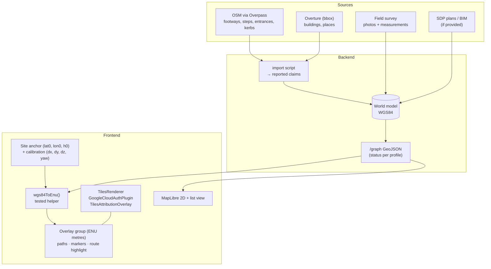

# 3D Scene Pipeline

> How the 3D scene is built and how our world model is drawn on top of it. Research, comparisons and licensing evidence: [../02-research/3d-data-and-rendering.md](../02-research/3d-data-and-rendering.md). Decision background: ADR [0002](../00-overview/decisions/0002-use-existing-3d-data.md). Owner: **Frontend** (Backend supplies GeoJSON).

## 1. Decision summary

| Layer | Choice | Fallback |
|---|---|---|
| Visual backdrop | **Google Photorealistic 3D Tiles** (Map Tiles API) | A: OSM/Overture extruded buildings + a hand-made glTF of the facility · B: SDP BIM/IFC if provided |
| Renderer | **`3d-tiles-renderer` (NASA-AMMOS) in React Three Fiber v9, WebGL2** | CesiumJS + Resium (decide after the Day-1 spike) |
| Overlay (our data) | three.js lines, instanced markers, drei `<Html>` labels in a local **ENU** group | same overlay on any backdrop |
| 2D / accessible fallback | **MapLibre GL** + the same GeoJSON + a text route list | always available |
| Offline / demo safety | Recorded video + fallback A works offline | |

**Iron rule (licence + honesty):** the tiles are for **display only**. Never trace, raycast-extract or derive our path geometry from the Google mesh. Paths come from OSM/Overture, the field survey or SDP plans, and the `source` on each edge records which.

## 2. Pipeline



## 3. Step by step

1. **Pin the site** (Day 1): one WGS84 anchor at the main entrance and a radius of about 300 m. This is stored in `GET /site` (`center`, `bbox`).
2. **Day-1 spike (2–3 h, FE):** load the site in (a) the 3d-tiles-renderer Google example, (b) the CesiumJS Sandcastle, (c) Google's `gmp-map-3d`. Screenshot each and judge (i) the tile quality at the facility and (ii) the effort. Record the result as ADR-0007. **If the tile quality is poor, switch to fallback A immediately.**
3. **API key:** a Google Cloud project with the Map Tiles API enabled (Enterprise SKU: 1,000 free events a month, then about USD 6 per 1,000; one root-tile request is about a 3-hour session). Restrict the key by HTTP referrer and to the Map Tiles API only. Set a budget alert at USD 10. *Check on Day 1 whether the student billing account can enable this SKU.* If not: Cesium ion Community (1,000 Google root tiles/month, non-commercial) or fallback A.
4. **Scene skeleton:**
   ```tsx
   <Canvas dpr={[1, 1.75]} frameloop="demand">
     <TilesRenderer>            {/* from '3d-tiles-renderer/r3f' */}
       <TilesPlugin plugin={GoogleCloudAuthPlugin} args={{ apiToken: KEY }} />
       <TilesAttributionOverlay />
     </TilesRenderer>
     <SiteFrame anchor={site.center} calibration={site.calibration}>
       <PathsLayer graph={graph} profile={profile} />
       <MarkersLayer places={places} />
       <RouteHighlight route={activeRoute} />
     </SiteFrame>
     <CameraRig target={focus} />  {/* fly-to driven by scene.highlight events */}
   </Canvas>
   ```
   Check the exact component and plugin names against `reference/repos/3d/3DTilesRendererJS/src/r3f/README.md`.
5. **Coordinates:**
   - `SiteFrame` = the ENU frame at the anchor (east = x, north = y, up = z, in metres), computed with the tiles renderer's ellipsoid helpers (`WGS84_ELLIPSOID…getEastNorthUpFrame`; verify the exact name).
   - `wgs84ToEnu(lon, lat)`: equirectangular is fine within 300 m (`east = R·cos(lat0)·Δlon`, `north = R·Δlat`, R = 6,378,137 m), with an error well under 1 m. Unit-test it against `pyproj`.
   - **Heights:** Google tiles use *ellipsoidal* height. Don't use MSL data. Set one constant ground offset per site by visual calibration (`dz`) and draw paths 0.3 m above it, with `depthTest` off for the route highlight so it never hides under the mesh.
   - **Calibration:** place 5 OSM building corners as debug pins, then adjust `(dx, dy, dz, yaw)` until they sit on the photoreal buildings. Store the result in `site.calibration`.
6. **Overlay styling** (WCAG: never colour alone):

   | Status for profile | Line | Pattern | Legend text |
   |---|---|---|---|
   | ok / verified | green `#1B873F` | solid | "Checked" |
   | unknown / stale | amber `#B7791F` | dashed | "Not checked yet" |
   | blocked | red `#C53030` | solid + ✕ markers | "Not passable" |
   | closed | red | dotted + 🚧 icon | "Closed until …" |
   | not relevant | grey, 40% opacity | thin | |

   The active route is a thicker tube (`Line2`, width 6 px) with an animated flow and an icon marker at each unknown segment.
7. **Markers:** instanced sprites by type (entrance, toilet, accessible toilet, seat, shelter, parking, OKU parking, drop-off) and drei `<Html>` labels on hover or focus. Keep fewer than 60 markers.
8. **Camera:** limit orbiting to the site radius. `focus_place` → fly-to over 800 ms, or an instant jump when `prefers-reduced-motion` is set.
9. **2D fallback:** MapLibre with an OSM-based basemap (check the tile provider's terms, or self-host a PMTiles extract for the bbox) and the same GeoJSON layers and colours. Switch to it automatically if WebGL init fails or tiles error for more than 8 s, and offer a manual toggle.
10. **Text/list mode:** the route as numbered steps, each with status text, plus place cards as a list. This is the screen-reader path.
11. **Attribution:** the Google credits (from tile metadata via `TilesAttributionOverlay`) plus "© OpenStreetMap contributors" plus "Overture Maps Foundation" where used.
12. **Performance budget:** a raised `errorTarget` on mobile, DPR ≤ 1.75, `frameloop="demand"`, overlay under 1k line segments. Test on one real mid-range Android phone in week 2.

## 4. Fallback A: open-data scene (build in week 2 as insurance)

1. Overture buildings for the bbox (`overturemaps download --bbox=… -f geoparquet --type=building`), or OSM buildings via Overpass.
2. Extrude to glTF with OSM2World (MIT) or a small three.js extruder (`ExtrudeGeometry` from footprints × `height` or `levels × 3.2 m`).
3. Optional: a hand-modelled facility in Blender (an hour of blocking out entrances, ramps and the canopy) exported as glTF.
4. The same `SiteFrame` and overlay apply unchanged, which proves the 3D layer is **swappable**. That is a good line for the scalability part of the pitch.

## 5. Future (pitch only, not built)
- **Own capture → Gaussian splats** (Spark renderer; Cesium has shipped hierarchical-LOD splat tiles; `KHR_gaussian_splatting` is at the Release Candidate stage). Feed-forward reconstruction (VGGT, MapAnything) is cutting capture time from hours to minutes.
- **SDP BIM/IFC** → indoor levels, lifts and door widths straight from authoritative design data (That Open Engine / web-ifc).
- In every case, accessibility facts still come from verification, not from the mesh.

## 6. Checklist for FE

- [ ] Day-1 spike done, ADR-0007 written
- [ ] API key restricted, with a budget alert
- [ ] `wgs84ToEnu` unit-tested against pyproj fixtures
- [ ] Calibration stored per site
- [ ] Overlay legend with text plus pattern (not colour alone)
- [ ] Auto-fallback to 2D works (test by disabling WebGL)
- [ ] Attribution visible
- [ ] Mid-range Android test passes (< 6 s interactive on 4G)
- [ ] Demo video recorded
