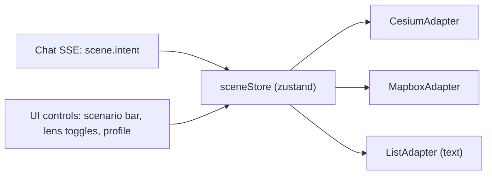

# 3D Scene Pipeline (CesiumJS hero)

> How the 3D township is built and how the world model is drawn on top of it. **Rewritten 15 Oct 2026** for ADR [0007](../00-overview/decisions/0007-3d-engine-cesium.md): CesiumJS + Resium is the hero engine. The earlier R3F + 3d-tiles-renderer design is superseded (it's in git history if needed).
> Research: [township-3d-engine-and-data](../02-research/township-3d-engine-and-data.md) (engine comparison, Cesium API names checked against 1.146), [3d-data-and-rendering](../02-research/3d-data-and-rendering.md) (tile licensing), [flood-disaster-lens § 4](../02-research/flood-disaster-lens.md) (water visualisation). Owner: **Frontend**. The backend supplies per-lens GeoJSON and scenario polygons.

## 1. Views and fallbacks

| View | Tech | Shown when |
|---|---|---|
| **Hero 3D** | CesiumJS 1.146 + Resium 1.27, `createGooglePhotorealistic3DTileset` | `VITE_GOOGLE_MAPS_API_KEY` set, WebGL OK |
| Hero fallback | Same Cesium app: Cesium OSM Buildings + `createWorldTerrainAsync` | No Google key, or tiles look poor (needs `VITE_CESIUM_ION_TOKEN`, Community plan) |
| Lite 2.5D | Mapbox GL JS Standard via `react-map-gl/mapbox` | "Lite view" button, or low-end devices (`VITE_MAPBOX_TOKEN`) |
| **List / text** | React | Always available; the default with no tokens; screen-reader path |

**Iron rules**
1. Google tiles are a **backdrop only**: no height sampling, no tracing, no caching or offline use. Credits always on screen (`showCreditsOnScreen`).
2. Where water goes comes from the **backend DEM pipeline** (ADR [0010](../00-overview/decisions/0010-flood-lens-hand-scenarios.md)), never from the mesh.
3. The renderer only consumes **scene intents** and **per-lens GeoJSON**. No business logic in the view layer.

## 2. Scene-intent adapter



| Intent (`kind`) | Payload | Cesium | Mapbox lite | List |
|---|---|---|---|---|
| `camera.fly_to` | `center [lon,lat]`, `heading`, `pitch`, `range_m` | `camera.flyTo({destination, orientation, duration})`; `setView` if `prefers-reduced-motion` | `map.flyTo` | "Showing: <area>" |
| `place.focus` | `place_id` | Fly to place + pulse its billboard | `flyTo` + highlight | Scroll to the place card |
| `route.highlight` | `route_id`, GeoJSON, segment statuses | Clamped polylines per segment, styled by status | Line layer in slot `top` | Numbered steps with status text |
| `flood.set_level` | `scenario_id` | Show that scenario's water polygons; recolour edges by flood class | Fill + line layers | "Scenario River +3 m (indicative): N places likely cut off" |
| `layer.toggle` | `lens`, `visible` | Show/hide the entity collection | Layer visibility | Section toggle |

All intents are recorded, so **demo replays** are deterministic (`?replay=demo1`).

## 3. Cesium setup (skeleton)

```tsx
// features/scene/cesium/CesiumScene.tsx (lazy-loaded chunk)
<Viewer full requestRenderMode maximumRenderTimeChange={Infinity}
        baseLayerPicker={false} timeline={false} animation={false}
        geocoder={false} infoBox={false} selectionIndicator={false}>
  {/* in onReady: */}
  {/* const tiles = await Cesium.createGooglePhotorealistic3DTileset({ key }); */}
  {/* tiles.enableCollision = true;   // needed for CLAMP_TO_3D_TILE */}
  {/* tiles.maximumScreenSpaceError = isMobile ? 24 : 16; */}
  {/* viewer.scene.primitives.add(tiles); viewer.scene.globe.show = false; */}
  <AccessLayer />   {/* clamped polylines + billboards */}
  <FloodLayer />    {/* water polygons + flooded edges */}
  <WasteLayer />
  <CameraRig />     {/* applies camera intents */}
</Viewer>
```
Check the exact Resium/Cesium names against `reference/repos/3d/resium` and the Cesium 1.146 reference. Use `createWorldTerrainAsync` (not the legacy `createWorldTerrain`).

**Performance:** lazy-load Cesium; `requestRenderMode: true` (call `scene.requestRender()` after updates); `resolutionScale` 0.75 on mobile; cap tile memory; fewer than about 3k dynamic entities (batch static lines as `Primitive`s); a "Lite view" button. Test on one mid-range Android phone in week 2.

## 4. Drawing the lenses

### 4.1 Access lens
| Element | Cesium | Style (never colour alone) |
|---|---|---|
| Walk segments | `PolylineGraphics` with `clampToGround: true` and `classificationType: BOTH` (check `Entity.supportsPolylinesOnTerrain(scene)`) | verified OK = solid green; unknown/stale = dashed amber (`PolylineDashMaterialProperty`); blocked = red with ✕ billboards; closed = red dotted |
| Entrances, toilets, seating, shelters, parking | Billboards + labels, `heightReference: CLAMP_TO_3D_TILE` | Icon per type + text label on focus |
| Active route | A wider polyline + glow material + unknown markers | "Checked" / "Not checked yet" legend |

### 4.2 Flood lens
- **Water:** one `PolygonGraphics` per scenario polygon with `height = surface_height_m` (top face, ellipsoidal metres from `GET /scenarios/{id}`), `extrudedHeight` below the terrain, `perPositionHeight: false`, translucent material `Color.fromCssColorString('#1e6fb8').withAlpha(0.55)`. The depth test against the photoreal mesh makes it fill low ground only.
- **Rise animation:** interpolate between scenario levels. Spike option A: `CallbackProperty` on `height` (simple, but rebuilds geometry). Option B: a static `Primitive` whose `modelMatrix` moves along the local up vector (faster, needs a spike). Pick in week 1.
- **Edges:** `likely_flooded` = red solid · `possible` = striped/dashed red-amber · `unlikely` = normal access styling.
- **Places:** a "cut off" badge on facilities; evacuation centres as billboards with a ✓ reachable / ✕ unreachable badge and a source tag (`official_pps` vs `osm_candidate`).
- **Disclaimer banner:** always visible while a scenario is active ("Indicative scenario, not a forecast…" + MBSA/JPS/NADMA links).
- **Datum calibration:** the DEM is EGM2008 and the tiles are ellipsoidal. Compute one constant offset per area by matching the water polygon to a known flat surface (the Elmina lake), store it in `site.scene.datum_offset_m`, and document it.

### 4.3 Waste lens
Billboards per point type (recycling / e-waste / general) with a status badge; click → card with accepted items, verified date and links to MBSA/SWCorp.

## 5. Mapbox lite view
`mapbox://styles/mapbox/standard`. Our layers go into slots: walk network + flood fill in `middle`, routes + markers in `top`. The same GeoJSON and the same status → style mapping (a shared `styles.ts`). `lightPreset` follows the system theme. PMTiles is used only for heavy context layers (buildings, full footway network).

## 6. Day-1 spike (FE, half a day). Produces ADR-0007 confirmation
1. Google tiles at Lakeside Mall (`3.1813, 101.5099`): screenshot the quality at 3 zoom levels (5-minute check, [research § 2.4](../02-research/township-3d-engine-and-data.md)).
2. One clamped polyline and one `CLAMP_TO_3D_TILE` billboard.
3. A translucent water polygon animated 0 → 3 m near Sungai Subang.
4. `flyTo` from a whole-Elmina view to the park.
5. Credits visible. Run on one mid-range Android phone; note the FPS and load time.
If tiles look poor, switch to the Cesium OSM Buildings fallback and record that in the ADR.

## 7. FE checklist
- [ ] Day-1 spike done, ADR-0007 confirmed or amended
- [ ] API keys referrer-restricted; budget alerts set
- [ ] Scene-intent adapters for Cesium, Mapbox and list share one `styles.ts`
- [ ] Datum offset calibrated and stored
- [ ] Disclaimer banner shown whenever a scenario is active
- [ ] Legend uses pattern + text, not colour alone
- [ ] Auto-fallback to the list view with no WebGL or tokens
- [ ] Mobile test passes (interactive in < 8 s on 4G)
- [ ] Demo replay recorded
