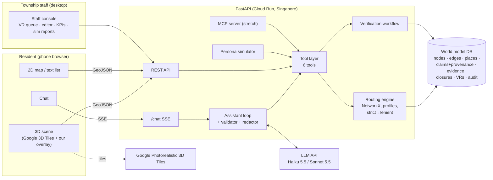

# Architecture Overview

> Start here before reading the detailed architecture docs. One page, one diagram, the boundaries.

## The system in one picture

## Five rules that keep it coherent

1. **The world model is the only source of truth** (ADR [0003](../00-overview/decisions/0003-structured-world-model-is-source-of-truth.md)). The 3D scene is decoration; the LLM is a translator.
2. **One tool layer, many consumers.** The chat loop, REST, the simulator and MCP all call the same Python functions in `packages/spatial/tools.py`.
3. **Unknown is a value** (ADR [0004](../00-overview/decisions/0004-tri-state-accessibility-attributes.md)). Route statuses: `confirmed`, `partly_unverified`, `blocked`, `no_data`.
4. **The server computes trust; the LLM only phrases it.** Evidence status, dates and badges come from the DB, and the validator rejects uncited claims.
5. **WGS84 in the backend, ENU in the frontend.** Only `wgs84ToEnu()` knows about scene coordinates.

## Read next (by role)

| Doc | BE | FE | AI |
|---|---|---|---|
| [stack-decision.md](stack-decision.md): versions, hosting, repo layout | ● | ● | ● |
| [api-contract.md](api-contract.md): endpoints, SSE events, canonical tool names | ● | ● | ● |
| [world-model-schema.md](world-model-schema.md): entities, claims, profiles, routing algorithm | ●●● | ● | ●● |
| [ai-assistant-design.md](ai-assistant-design.md): tools, prompt, validator, VR triggers | ● | ● | ●●● |
| [3d-pipeline.md](3d-pipeline.md): tiles, ENU overlay, fallbacks | | ●●● | |
| [resident-agents-design.md](resident-agents-design.md): persona simulator | ● | ● | ●●● |

## Canonical names cheat-sheet

| Thing | Canonical name(s) |
|---|---|
| Profiles | `default`, `stroller`, `wheelchair`, `older_adult_rest` |
| Tools | `find_place`, `get_place_details`, `plan_route`, `nearby_amenities`, `get_closures`, `create_verification_request` (+ `final_answer`) |
| Route status | `confirmed`, `partly_unverified`, `blocked`, `no_data` |
| Claim status | `unknown`, `reported`, `verified`, `stale`, `contested` |
| Per-element evaluation | `PASS`, `FAIL`, `UNKNOWN` |
| SSE events | `text.delta`, `tool.call`, `tool.result`, `scene.highlight`, `citation`, `uncertainty`, `verification.requested`, `error`, `done` |
| ID prefixes | `n-` node, `ent-` entrance, `seg-` edge, `ev-` evidence, `vr-` verification request, `rt-` route |

> The research docs sometimes use slightly different names (e.g. `walker_rest_points`, `route`, `map_action`). **The names in this table win.**
