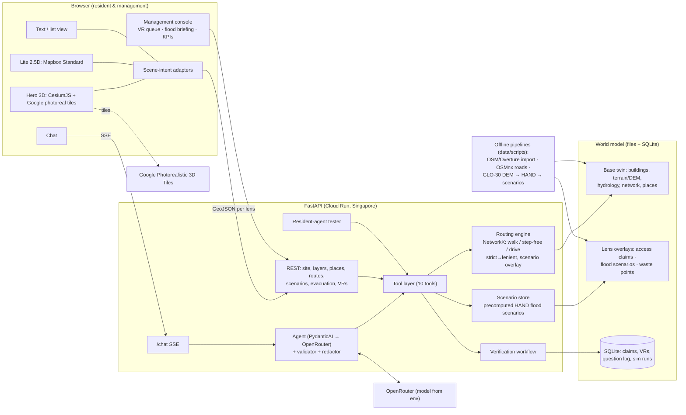

# Architecture Overview

> Start here before reading the detailed architecture docs. One page, one diagram, the boundaries, and the **canonical names** every lane uses.
> Updated 15 Oct 2026 for the Township World Model platform (ADRs [0007](../00-overview/decisions/0007-3d-engine-cesium.md), [0008](../00-overview/decisions/0008-agent-harness-pydantic-ai.md), [0009](../00-overview/decisions/0009-township-world-model-platform.md), [0010](../00-overview/decisions/0010-flood-lens-hand-scenarios.md)).

## The system in one picture

## Rules that keep it coherent

1. **The world model is the only source of truth** (ADR 0003). The 3D scene is presentation; the LLM is a translator.
2. **Base twin + lens overlays.** One shared base (buildings, terrain, hydrology, network, places). Each lens adds overlays (claims, scenarios, points). New lens = new overlay + tools + views, with no changes to the base.
3. **One tool layer, many consumers.** Chat, REST, the resident-agent tester and (stretch) MCP all call the same Python functions in `packages/spatial/tools.py`.
4. **Unknown is a value** (ADR 0004). Flood scenarios can only add FAIL/UNKNOWN, never PASS (ADR 0010).
5. **The server computes trust; the LLM only phrases it.** Evidence status, dates, disclaimers and badges come from data; the validator rejects uncited claims.
6. **Scene intents, not renderer calls.** The AI and UI emit typed intents; adapters for Cesium, Mapbox and the list view draw them.
7. **Hydrology never comes from Google tiles.** Heights and water extents come from the DEM pipeline only (licence + honesty).
8. **WGS84 everywhere in data and the API.** Renderer-specific transforms (datum offset, clamping) live only in the FE adapters.

## Read next (by role)

| Doc | BE | FE | AI |
|---|---|---|---|
| [stack-decision.md](stack-decision.md): versions, hosting, repo layout (see the superseded notes) | ● | ● | ● |
| [api-contract.md](api-contract.md): endpoints, SSE events, scene intents, tools | ● | ● | ● |
| [world-model-schema.md](world-model-schema.md): base twin, claims, profiles, routing, **§10 lenses & scenarios** | ●●● | ● | ●● |
| [ai-assistant-design.md](ai-assistant-design.md): tools, prompt, validator, VR triggers, flood guardrails | ● | ● | ●●● |
| [3d-pipeline.md](3d-pipeline.md): Cesium hero, water, layers, fallbacks | | ●●● | |
| [resident-agents-design.md](resident-agents-design.md): tester incl. flood invariants | ● | ● | ●●● |
| [../02-research/flood-disaster-lens.md](../02-research/flood-disaster-lens.md): flood data and method | ●●● | ● | ●● |

## Canonical names cheat-sheet

| Thing | Canonical name(s) |
|---|---|
| Lenses | `access` (accessibility & getting around), `flood` (flood / disaster what-if), `waste` (recycling & waste) |
| Profiles | `default`, `stroller`, `wheelchair`, `older_adult_rest`, `drive` (flood lens) |
| Tools (10) | `find_place`, `get_place_details`, `plan_route` (+ optional `scenario_id`), `nearby_amenities`, `get_closures`, `create_verification_request`, `list_flood_scenarios`, `affected_places`, `list_evacuation_centres`, `find_waste_points` (+ forced output `final_answer`) |
| Flood scenarios | `baseline`, `stage_p1m`, `stage_p2m`, `stage_p3m`, `stage_p4m`, `stage_p5m` (river stage +N m, indicative) |
| Edge flood class | `likely_flooded` → FAIL, `possible` → UNKNOWN, `unlikely` → normal rules |
| Evacuation centre source | `official_pps`, `osm_candidate` |
| Route status | `confirmed`, `partly_unverified`, `blocked`, `no_data` |
| Claim status | `unknown`, `reported`, `verified`, `stale`, `contested` |
| Per-element evaluation | `PASS`, `FAIL`, `UNKNOWN` |
| SSE events | `text.delta`, `tool.call`, `tool.result`, `scene.intent`, `citation`, `uncertainty`, `disclaimer`, `verification.requested`, `error`, `done` |
| Scene intents (`scene.intent.kind`) | `camera.fly_to`, `place.focus`, `route.highlight`, `flood.set_level`, `layer.toggle` |
| ID prefixes | `n-` node, `ent-` entrance, `seg-` walk edge, `road-` drive edge, `ev-` evidence, `vr-` verification request, `rt-` route, `pps-`/`evc-` evacuation centre, `wp-` waste point |
| Areas (bbox S,W,N,E) | Elmina envelope `3.150,101.460,3.240,101.530` (clip to polygon) · access deep spot `3.1775,101.5055,3.1835,101.5135` · flood analysis area = envelope + downstream Sungai Subang corridor (fixed in week 1) |

> Older docs and the research notes sometimes use other names (`walker_rest_points`, `route`, `map_action`, `scene.highlight`, `simulate_flood`). **The names in this table win.**
