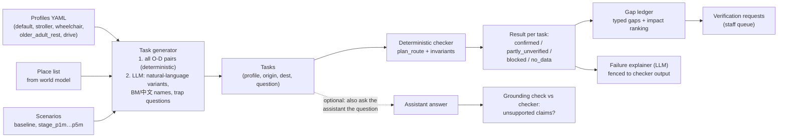

# Resident-Agent Simulation: Design

> Implementation design for feature group G (see [mvp-spec](../03-product/mvp-spec.md)). Updated 15 Oct 2026: the tester now also runs **flood scenarios** (lens `flood`) and the `drive` profile ([ADR 0009](../00-overview/decisions/0009-township-world-model-platform.md), [ADR 0010](../00-overview/decisions/0010-flood-lens-hand-scenarios.md)). Research, critique and evidence: [../02-research/resident-agent-simulation.md](../02-research/resident-agent-simulation.md). Owner: **AI** (runner, LLM parts), with **Backend** (routing/invariants it calls).

## 1. What these agents are and aren't

| They ARE | They are NOT |
|---|---|
| Deterministic **constraint profiles** + **tasks**, checked by the routing engine | LLM role-play of residents |
| A **test suite** for the world model (like property-based testing) | Predictions of how real residents feel or behave |
| A way to **find and rank information gaps** before residents hit them | A substitute for consultation with real residents and OKU groups |

**Why:** research shows LLM "disability personas" are homogenised and idealised, and that high-fidelity agent simulation needs hours of real interview data per person. We avoid both problems by letting the LLM generate *questions*, not *verdicts*. Use this framing in the pitch; judges will respect it.

## 2. Pipeline



The optional dotted branch is valuable: the same tasks become an **automatic eval of the chat assistant**. Does its answer agree with the checker? Does it mention every unverified segment?

## 3. Components

### 3.1 Profiles
YAML in `config/profiles/`, loaded by `packages/spatial` and shared with the router (one definition, no drift). Profiles: `default`, `stroller`, `wheelchair`, `older_adult_rest` and `drive` (flood lens: township road graph, used for evacuation-by-car and road closures; car depth limit about 0.3 m, versioned and shown to users). Flood depth thresholds sit next to the profiles as versioned YAML. Schema:

```yaml
id: older_adult_rest
version: 1
label: "Older resident needing rest points"
hard:
  max_step_count: 0
  max_incline_pct: 8.3
  max_rest_free_run_m: 100
soft:
  covered_multiplier: 0.86
  unlit_after_19_multiplier: 1.3
unknown_policy: strict_then_lenient
variants:
  frail: { hard: { max_rest_free_run_m: 50 } }
rationale_sources: [activetravelengland-benches, un-enable-design-manual, melnikov2022-shade]
```

### 3.2 Task generator
1. **Deterministic core:** for each profile, every pair in `(parking ∪ drop_off ∪ bus_stop) × (facility main entrances ∪ toilets)` plus the reverse. This gives about 30–80 tasks for one site.
   **Flood core:** for each `scenario × profile`, every residential/anchor origin × the evacuation centres (`official_pps` and `osm_candidate`). Walking profiles use the walk graph, `drive` uses the road graph.
2. **LLM augmentation** (cheap model, temperature 0.7, cached to `evals/tasks/generated/*.jsonl`, reviewed by a human before committing):
   - natural-language phrasings in EN / BM / 中文 / Manglish ("boleh bawa stroller dari parking ke dewan tak?")
   - aliases and misspellings of place names
   - **trap tasks**: places we don't model, impossible requests, and "is it safe?" questions (the expected outcome is abstain or `no_data`); for flood, "will my house flood?", "is Dewan X safe at +3 m?" and "how deep will it be on this path?" (expected: indicative-scenario wording, no "safe", no exact depth)
3. Each task: `{ id, profile, scenario_id?, origin, destination, question, lang, expected_outcome?, source: "od_pairs|llm" }`.

### 3.3 Checker
Calls `plan_route` directly (no HTTP) and evaluates **invariants** on the result and graph:

| # | Invariant | Gap type on violation |
|---|---|---|
| I1 | No returned route contains a FAIL element for its profile | `bug` (a code defect, fails CI) |
| I2 | Every non-verified element on a route is in `unknowns[]` | `bug` |
| I3 | Every facility main entrance is reachable from ≥ 1 parking/drop-off per profile | `no_accessible_access` |
| I4 | Monotonicity: relaxing constraints never removes a route | `bug` |
| I5 | Every attribute used in a decision has a source and isn't stale | `missing_attr` / `stale_attr` |
| I6 | Each facility has a defined main accessible entrance; toilets/seating have `wheelchair`/`seating` claims | `place_coverage` |
| I7 | `older_adult_rest`: the longest rest-free run ≤ the limit | `rest_gap_exceeds_limit` |
| I8 | No conflicting claims (`contested`) on route elements | `contradiction` |

### 3.3b Flood invariants and tasks (per scenario × profile)

For every scenario in `baseline, stage_p1m … stage_p5m` and every profile, the checker runs the same `plan_route(..., scenario_id)` and `list_evacuation_centres` tools the assistant uses.

| # | Invariant | Gap type / severity on violation |
|---|---|---|
| F1 | **Reachability:** at least one evacuation centre is reachable per profile and scenario (route status `confirmed` or `partly_unverified`). If none is, this is a finding, not a pass: report the profile, scenario and the isolated component | `no_evacuation_access` (finding for managers, ranked by residents affected); a code defect only if the engine returns a route it should not |
| F2 | **Monotonicity across stages:** a higher stage never un-floods an edge, and never turns a `blocked` route into `confirmed` (`stage_pNm` ⊇ `stage_p(N-1)m` in `likely_flooded`) | `bug` (fails CI; Hypothesis property test) |
| F3 | **No route through `likely_flooded` edges** for the profile (and none through `possible` edges without listing them in `unknowns[]`) | `bug` (fails CI) |
| F4 | **Disclaimer present:** every assistant answer that used a scenario tool contains the scenario disclaimer ("indicative scenario, not a forecast"), cites the scenario provenance, and never says "safe" or states an exact depth | `unsupported_claim` / `missing_disclaimer` (fails the eval) |
| F5 | A scenario never turns an `UNKNOWN` into `PASS` (it can only add FAIL/UNKNOWN) | `bug` (fails CI) |
| F6 | Evacuation centres carry their source (`official_pps` or `osm_candidate`); `osm_candidate` is never described as an official PPS | `source_mislabel` |

**Flood tasks:** (a) "Priya (wheelchair) at Lakeside: where can she go at +3 m?"; (b) "Aisyah with a stroller, nearest centre at +2 m"; (c) a `drive` evacuation at each stage; (d) isolated-island cases (a profile with no route out) where the right answer is "no confirmed route, contact MBSA/JPS/NADMA, here is what is unknown"; (e) trap tasks listed above. The gap ledger ranks flood gaps like any other: the `impact` of an UNKNOWN edge is the number of `scenario × profile × centre` tasks that flip if it were PASS, and each top gap can open a VR for staff (for example "verify kerb ramp X").

### 3.4 Gap ledger and ranking
- Group findings by `(element_id, attribute)`.
- `impact` = the number of tasks that flip to `confirmed` if this element were PASS ("minimal-cut" via flip-and-reroute; see [world-model-schema § 6.1](world-model-schema.md)).
- Output: `top_gaps[]`, each with `{element_id, attribute, gap_type, impact, affected_profiles, example_task_ids}` plus a one-click "create VR".

### 3.5 Failure explainer (LLM, fenced)
- Input: **only** the structured result (route status, blocking elements, unknowns, evidence).
- Output: 1–2 sentences, which must quote element IDs.
- Post-check: reject the output if it contains any ID or number not present in the input (a regex plus set comparison), then retry once. Otherwise fall back to a template sentence.

### 3.6 Run report
`sim_runs` row + `sim_results` rows; the staff UI renders:
- Outcome matrix (profile × outcome counts), **before vs after** the last staff verification batch, plus a **scenario × profile** matrix for the flood lens (centres reachable, islands).
- Top 10 gaps by impact.
- Coverage: % of route-relevant attributes verified; median fact age.
- Assistant agreement (if the dotted branch ran): % of answers consistent with the checker, plus the count of unsupported claims.

## 4. Evaluation of the simulator itself

- **Seeded-fault (mutation) test:** a script injects hidden barriers (adds steps to a confirmed edge, removes a bench, closes a walkway) and asserts the suite detects each one. Report the detection rate. **Good demo moment:** "we hid 5 faults; it found 5/5 and told staff which to fix first."
- **Human check:** 3–5 people walk 2–3 routes during the field visit; compare their experience with the checker's verdicts and report disagreements honestly.
- **CI:** the deterministic suite (without LLM augmentation) runs on every change to `data/seed/` or `packages/spatial/`; I1, I2, I4, F2, F3 and F5 failing breaks the build. F4 runs in the eval job with `LLM_PROVIDER=mock` for the canned cases and with a real model on demand.

## 5. Pitch metrics produced by this component
- Tasks: N generated; % confirmed / partly unverified / blocked per profile, **before → after** one verification round.
- Flood: for each stage, the number of evacuation centres reachable per profile and the number of isolated residents/places (indicative; labelled as such).
- Gaps found by the suite vs gaps found by a human walkthrough.
- Staff minutes per gap closed (timed during the field visit).
- Seeded-fault detection rate.

## 6. Out of scope (deliberately)
Generative-agent memory/reflection, crowd simulation, behaviour or opinion prediction, "how difficult does this feel" scoring. Each is high risk with no judging upside.
