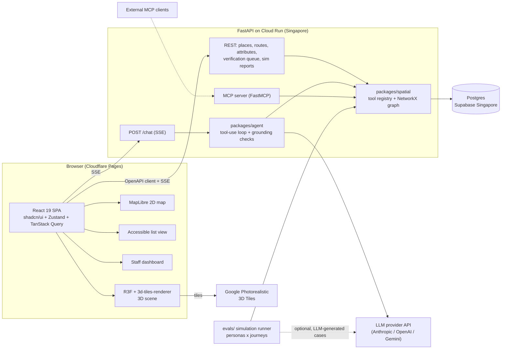

# Stack Decision: TownshipLens engineering stack

Status: proposed, 2026-10-14. Scope: frontend, backend, AI integration, deployment, repo layout. Versions were checked with `npm view` / `pip index versions` on 2026-10-14. Free-tier numbers come from third-party summaries unless noted and are marked "(unverified)"; re-check vendor pages before relying on them.

## TL;DR

- **Frontend:** Vite 8 + React 19.3 single-page app (no SSR needed), React Three Fiber 9.8 + drei 10.7 + `3d-tiles-renderer` 0.5 for the 3D scene, MapLibre GL + react-map-gl 8 for the 2D fallback, Tailwind v4 + shadcn/ui, Zustand + TanStack Query. Chat is a thin custom SSE hook with a typed event vocabulary (text, tool, highlight, citation) rather than a generic chat kit.
- **Backend:** FastAPI 0.143 + Pydantic 2.14, managed with uv. NetworkX 3.7 for the graph (500 edges; speed is irrelevant). SQLAlchemy 2 + Alembic; SQLite locally, Postgres (Supabase, Singapore) when deployed. No PostGIS: shapely 2 + pyproj in Python, GeoJSON as interchange.
- **AI:** The tool-use loop runs in Python inside the API. The tools are plain Python functions in one shared package, exposed three ways: native tool schemas for the chat loop, an MCP server (FastMCP) for external agents, and direct calls from the simulation runner. One definition, three consumers.
- **Contract:** OpenAPI from FastAPI is the source of truth. The generated TS client (`@hey-api/openapi-ts`) is committed. The chat SSE event schema is published as a Pydantic model and appears in OpenAPI as a documented component.
- **Hosting:** Frontend on Cloudflare Pages. API on Google Cloud Run in `asia-southeast1` (scale to zero). DB on Supabase Singapore free tier with a keep-alive ping. Render free is the fallback for the API.
- **Repo:** pnpm + uv monorepo (`apps/web`, `apps/api`, `packages/*`, `data/`, `evals/`), trunk-based with short PRs, Biome + ruff, vitest + pytest + Playwright, GitHub Actions.
- **Biggest risks:** Google Photorealistic 3D Tiles terms and quota (see Risks), Supabase free pause, and cold starts on a scale-to-zero API during the demo.

## 1. Frontend

### 1.1 Framework: Vite SPA vs Next.js

| Option | Pros | Cons | Verdict |
|---|---|---|---|
| Vite 8 + React 19.3 SPA | Tiny mental model, instant HMR, static hosting on any CDN free tier, no server runtime to deploy, R3F is client-only anyway | No SSR/SEO (irrelevant for a demo app), routing via React Router / TanStack Router | **Choose** |
| Next.js 16.4 | Familiar, SSR, API routes | Adds a Node server concern (Vercel-coupled), RSC/client boundaries add friction around Canvas, duplicates a backend we already have in FastAPI | Reject |

Vite 8 is current (8.3.4). React 19.3.0, TypeScript 7.0.2 is available (a major jump; if any tool chokes, pin TS 5.9.x; compatibility unverified).

### 1.2 3D and 2D

| Concern | Choice | Version | Notes |
|---|---|---|---|
| 3D renderer | `three` + `@react-three/fiber` | three 0.186.1, R3F 9.8.1 | R3F v9 targets React 19. Pin three to a minor; it ships breaking changes often. |
| Helpers | `@react-three/drei` | 10.7.9 | Controls, Html labels, Line/Text. |
| 3D Tiles | `3d-tiles-renderer` (NASA-AMMOS) | 0.5.3 | Has an official R3F entry `3d-tiles-renderer/r3f` with `TilesRenderer`, `TilesPlugin`, `GlobeControls`, `TilesAttributionOverlay`, and `GoogleCloudAuthPlugin` (Context7 docs, source `src/r3f/README.md`). 0.x: pin exact version. |
| 2D map | `maplibre-gl` + `react-map-gl/maplibre` | 6.14.0 / 8.1.3 | Open-source, no token; use OSM-based vector/raster tiles (check the tile provider's usage terms; unverified) or a self-hosted PMTiles file for the site area. |
| Route/graph overlay | GeoJSON layers | n/a | The same GeoJSON from the API feeds both the 3D polyline (converted to local ENU) and the 2D map layers. |

Design rule: the **graph is in WGS84 lon/lat in the API**. The frontend converts to scene coordinates with one tested helper (`packages/geo-ts`, wrapping the tiles renderer's ellipsoid utilities or a simple local ENU transform). Do not let the AI or backend know about scene coordinates.

If the 3D data is not Google tiles (for example a custom glTF or an OSM extrusion), the same app works with `useGLTF` and the same ENU helper; the 3D layer is isolated behind a `<SceneView>` component so the 2D map and list views do not depend on it.

### 1.3 UI kit and state

| Concern | Choice | Version |
|---|---|---|
| Styling | Tailwind CSS v4 | 4.3.3 |
| Components | shadcn/ui (Radix-based, copy-in) via `shadcn` CLI | 4.21.5 |
| Client state | Zustand (selected place, highlighted route, view mode, a11y prefs) | 5.0.15 |
| Server state | TanStack Query | 5.104.2 |
| Routing | React Router or TanStack Router (either; pick React Router for familiarity) | (unverified current version) |

### 1.4 Chat streaming

| Option | Pros | Cons |
|---|---|---|
| **Custom SSE hook** (fetch + ReadableStream, typed events) | Full control of non-text events (tool calls, route highlight, citations, uncertainty flags); no coupling to a TS-side AI SDK; ~100 lines | Must write reconnection and abort handling |
| Vercel AI SDK UI `useChat` (`ai` 7.0.140, `@ai-sdk/react` 4.0.143) with a Python backend emitting its data stream protocol | Ready-made message state, streaming helpers | Protocol changed across major versions; a Python emitter must track it (stability unverified for v7); custom parts like "highlight route" still need data parts |
| assistant-ui (`@assistant-ui/react` 0.15.28) | Polished chat primitives, runtime adapters, a11y-minded | Another abstraction; 0.x; custom runtime wiring needed |

**Decision:** custom SSE with a small typed event union, generated from a Pydantic model so frontend and backend cannot drift:

```
event: text.delta        data: {"id","delta"}
event: tool.call         data: {"id","name","args"}      // shown as "Checking route..." chips
event: tool.result       data: {"id","summary"}
event: scene.highlight   data: {"route_id"|"place_ids","geojson"}
event: citation          data: {"place_id","attribute","status","verified_at","source"}
event: verification.requested data: {"request_id","reason"}
event: done              data: {"message_id"}
```

If time allows, swap the message-list rendering to assistant-ui primitives; the event stream stays the same. This is explicitly a "no day-1 dependency" choice.

### 1.5 Accessibility of the web UI itself

This is an accessibility-focused product, so the UI is judged on it.

- Target WCAG 2.2 AA. Use Radix/shadcn primitives (focus management, ARIA), visible focus rings, 24px minimum targets (WCAG 2.2 target size), no drag-only interactions.
- **The 3D canvas is never the only way to get information.** Every route and place has a text equivalent in an ordered list (step-by-step directions with attributes and verification status), plus the 2D map. Provide a "View as: 3D / 2D map / List" switch, defaulting to List on `prefers-reduced-motion` or low-power devices.
- Chat: `aria-live="polite"` region for streamed answers (announce on completion, not per token), proper form labels, Enter to send, Escape to cancel.
- Keyboard: the 3D view gets arrow-key camera movement and "focus next place" shortcuts; the canvas has a skip link.
- Respect `prefers-reduced-motion` (no auto-flying camera) and `prefers-color-scheme`. Colour is never the sole carrier of verified/unverified status: use icon + text label.
- Test: `@axe-core/playwright` in CI on the list, map, chat, and dashboard pages. Manual screen-reader pass (VoiceOver) once before demo.

## 2. Backend

### 2.1 Core

| Concern | Choice | Version | Why |
|---|---|---|---|
| Web framework | FastAPI | 0.143.1 | OpenAPI for free, async, streaming |
| Validation | Pydantic v2 | 2.14.1 | Shared models for API + tool schemas + LLM structured output |
| Server | uvicorn | 0.54.0 | |
| Packaging | uv | 0.12.5 | Workspaces, lockfile, fast CI |
| Lint/format | ruff | 0.17.0 | |
| Tests | pytest, pytest-asyncio, httpx | 9.1.1 / 1.4.0 / 0.28.1 | |
| SSE | native `StreamingResponse` (or `sse-starlette` 3.5.0) | | FastAPI may also have built-in SSE helpers in recent versions (unverified); use `sse-starlette` if not. |

### 2.2 Graph library

| Lib | Version | For this project |
|---|---|---|
| **NetworkX** | 3.7 | Pure Python, readable, shortest-path with custom weight/filter functions, trivially serialisable to node-link JSON. 500 edges is microseconds. **Choose.** |
| rustworkx | 0.18.1 | Faster, less ergonomic; unnecessary at this scale |
| igraph | 1.0.0 | C core, extra dependency weight, no benefit here |

Constraint-aware routing = build a **filtered view** per persona (`nx.subgraph_view` with an edge filter such as `step_free is True and verified`), then `shortest_path` on a weight (length, plus penalties for unverified). Return both the route and the list of edges excluded for *unknown* status; that list is what drives verification requests and "I can't confirm this section".

### 2.3 Database

| Option | Pros | Cons | Verdict |
|---|---|---|---|
| SQLite file | Zero setup, great for dev and tests | Cloud Run disk is ephemeral; staff edits would be lost | Dev and test only |
| Postgres + PostGIS (Supabase/Neon) | Real spatial SQL | PostGIS is overkill for ~500 edges; adds setup and migration burden | Skip PostGIS |
| **Postgres (Supabase, Singapore), no PostGIS** | Persistent, free tier, shared by 3 devs and by prod, JSONB for attributes | Free project pauses after 7 days idle (third-party sources, unverified); 500 MB cap (plenty) | **Choose** for deployed env |

ORM: **SQLAlchemy 2.1 + Alembic 1.20** with Pydantic schemas separate from ORM models. SQLModel 0.0.48 is pre-1.0 and couples the two; avoid. Driver: `psycopg` 3.3. Same code runs on SQLite (local) and Postgres (deployed); avoid Postgres-only features except JSONB via SQLAlchemy's generic `JSON` type.

Core tables: `place`, `entrance`, `edge` (with `from`, `to`, `geometry` GeoJSON, `length_m`), `attribute` (subject_id, key, value, status in `verified|unverified|disputed|stale`, `source`, `verified_by`, `verified_at`), `verification_request` (subject, question, trigger, status, created_at, resolved_by), `audit_log` (who changed what, previous value), `chat_session`, `sim_run`, `sim_journey`. Provenance is columns on `attribute`, not a separate system.

Source of truth for the seed graph: GeoJSON files in `data/` committed to git, loaded by an idempotent `seed` command. Staff edits live in the DB and can be exported back to GeoJSON for review.

### 2.4 Geospatial

`shapely` 2.2 (lengths, distance, snapping), `pyproj` 3.8 (WGS84 to local ENU or a local UTM zone, Malaysia is UTM 47N/48N; EPSG:32648 for most of Peninsular east and Borneo, EPSG:32647 for the west; verify for the site). GeoJSON is the only wire format for geometry. Coordinates in the API are always `[lon, lat]` WGS84.

### 2.5 Staff auth

| Option | Effort | Verdict |
|---|---|---|
| Shared secret in `Authorization` header | 10 min | OK for dev |
| **Named staff accounts from env/DB + password login -> signed JWT in httpOnly cookie** | ~2 hours, using `pyjwt` + `pwdlib` | **Choose**: gives an audit trail (who edited what) that the pitch values |
| Supabase Auth (magic link) | Extra SDK on both sides, email deliverability risks during a demo | Only if time remains |

Roles: `resident` (anonymous, rate-limited), `staff` (edit and resolve requests). Rate-limit the chat endpoint per IP (e.g. `slowapi`) to protect the LLM key.

## 3. AI layer integration

Compared:

| Option | Pros | Cons |
|---|---|---|
| A. Python loop in FastAPI with provider SDK (`anthropic` 1.13.0, `openai` 3.31.0, `google-genai` 2.30.1) | Tools sit next to graph code; AI person works in Python; one place for logging, evals, sim | Frontend can't reuse TS AI SDK helpers |
| B. TypeScript loop with Vercel AI SDK, Python exposes tools over HTTP/MCP | Good UI helpers | Splits AI logic across languages; AI student owns TS too; tool latency doubles |
| **C. A + MCP server exposing the same tools** | Same tools usable from Claude Desktop/agents, the sim runner and external judges; a good demo story | Slight extra work |

**Decision: C.**

```
packages/spatial/          # pure Python, no web deps
  graph.py                 # load from DB/GeoJSON -> NetworkX
  tools.py                 # find_place, find_nearby, route, get_attributes, request_verification ...
  schemas.py               # Pydantic IO models (single source of tool schemas)
apps/api/                  # FastAPI: REST + /chat SSE + /staff + mounts MCP
packages/agent/            # provider-agnostic loop, prompts, grounding checks, persona definitions
apps/sim/ (or evals/)      # runner: personas x journeys -> calls tools directly, writes report
```

- The tool registry in `spatial/tools.py` is a list of `(name, description, input model, callable)`. Adapters generate: Anthropic/OpenAI/Gemini tool JSON schema from Pydantic; a FastMCP server (`fastmcp` 4.1.0; the official `mcp` SDK is 2.3.0, and both are new majors, so check the docs with `ctx7` on day 1); and a direct-call table for the simulator.
- Every tool result carries `status` and `source` fields. The system prompt and a post-check enforce "no claim without a tool result"; unverified attributes must be phrased as unverified. The final answer returns citations as structured data (the `citation` SSE events), not only prose.
- Use one default model plus a cheap one for simulation; keep the model id and provider in env (`LLM_PROVIDER`, `LLM_MODEL`). Prompt caching on the long system prompt and tool list reduces cost (provider docs; unverified for current limits). Do not hard-code model names in code.
- The simulator is deterministic first: a persona is constraints (`step_free`, `max_continuous_walk_m`, `needs_rest_every_m`), the routing engine decides feasibility, and the LLM only generates journey variations and explains failures. This matches the original idea ("a structured engine checks feasibility").

### API contract

- `apps/api` exports `openapi.json` (a `just`/`pnpm` script). CI regenerates and fails on diff.
- Frontend client: **`@hey-api/openapi-ts` 0.99.0** (typed fetch client, TanStack Query plugin available; 0.x, pin exactly). Alternatives: `openapi-typescript` 7.13.0 + `openapi-fetch` (smallest), `orval` 8.42.0 (generates query hooks, heavier).
- Contract-first handoff: the backend dev merges a stub endpoint returning fixture data on day 2 so frontend and AI are never blocked. Fixtures live in `packages/fixtures/`.

## 4. Deployment

| Layer | Pick | Why / limits |
|---|---|---|
| Frontend | **Cloudflare Pages** | Static; free plan: 500 builds/month, 20,000 files, 25 MiB per asset (Cloudflare docs, https://developers.cloudflare.com/pages/platform/limits). Global CDN, fine from Malaysia. No stated commercial restriction. Vercel Hobby also works but is non-commercial-only per Vercel docs. |
| API | **Google Cloud Run, asia-southeast1 (Singapore)**, min instances 0 | Monthly free allowance 180,000 vCPU-s, 360,000 GiB-s, 2M requests (third-party summary; Google lists Singapore among the free-tier regions; verify at https://cloud.google.com/run/pricing). Needs a billing account (card). Cold start a few seconds: set `min-instances=1` for demo day only (small cost). |
| API fallback | Render free web service | Spins down after 15 min idle, ~1 min wake (Render docs, https://render.com/docs/free), 512 MB RAM, 750 hours/month. Singapore region exists (unverified). Free Render Postgres expires after 30 days: do not use it. |
| API not chosen | Fly.io | New orgs no longer get a free allowance, only a short trial (https://fly.io/docs/about/discontinued-plans/). |
| API not chosen | Hugging Face Spaces (Docker) | Free CPU basic space works but is unverified for stable SSE/CORS and cold sleep behaviour. |
| DB | **Supabase free, region Singapore (ap-southeast-1)** | 2 active free projects, 500 MB DB, pause after 7 idle days (third-party, unverified: https://www.jetadmin.io/blog/supabase-pricing-2026-guide-to-plans-limits-and-real-world-costs/). Add a daily GitHub Actions cron that hits `/healthz` (which runs `select 1`). Use the **Session/Transaction pooler** connection string from Cloud Run. Neon free is an equivalent alternative (unverified). |
| Secrets | Cloud Run env + Secret Manager (or plain env vars for the hackathon), Cloudflare Pages env for public vars only | LLM keys never reach the browser |

Cost target: near zero except LLM tokens. Set a hard monthly budget/alert on the LLM provider and Google Cloud billing.

**Google Photorealistic 3D Tiles caveat.** Per Google's usage page (https://developers.google.com/maps/documentation/tile/usage-and-billing), the SKU is billed per **root tile request**, with a max of 10,000 root tileset queries per day per project; regular renderer tile requests do not count toward that quota. The page does not state a price; the old $200/month credit ended 2025-02-28. Pricing and free thresholds: unverified, check the Maps Platform pricing list and enable a quota cap and a budget alert. The API key is exposed to the browser: restrict it by HTTP referrer and to the Map Tiles API only. Google's policies require attribution (use `TilesAttributionOverlay`) and restrict caching/derivative use: read https://developers.google.com/maps/documentation/tile/policies before pitching. A fallback (OSM-extruded buildings or a permitted glTF capture) should be prepared by week 2.

## 5. Repo and workflow (summary; full detail in `docs/05-team/dev-setup.md`)

- Monorepo: `apps/web`, `apps/api`, `packages/{spatial,agent,fixtures,api-client}`, `data/`, `evals/`, `docs/`.
- Tooling: pnpm 12.x workspaces (current 12.11.2; use the Node version in `.nvmrc`), uv workspace, Biome 2.5 (single tool for lint + format of TS/JSON/CSS), ruff, vitest 5.0 + Testing Library, pytest, Playwright 1.64, pre-commit (or lefthook), GitHub Actions.
- Git: trunk-based; PRs under ~300 lines, one approval from a teammate, squash merge, branch names `role/short-topic`, Conventional Commits. `main` is always deployable (CI deploys on merge).
- Env: `.env.example` committed, `.env` ignored, gitleaks in pre-commit and CI.

## 6. Architecture



Role boundaries: **Frontend** owns `apps/web` and consumes only the OpenAPI client plus the SSE event schema. **Backend** owns `apps/api`, DB, migrations, `packages/spatial` (graph and tools implementation), auth, deployment. **AI** owns `packages/agent`, prompts, personas, `evals/`, and the MCP adapter; touches tool *descriptions* and schemas via PR reviewed by backend.

## 7. Decision table (versions as of 2026-10-14)

| Area | Choice | Version |
|---|---|---|
| Node / pnpm | Node 22 or 24 LTS (verify), pnpm | 12.11.2 |
| Bundler | Vite | 8.3.4 |
| UI | React, TypeScript | 19.3.0, 7.0.2 (fallback 5.9) |
| 3D | three, R3F, drei, 3d-tiles-renderer | 0.186.1, 9.8.1, 10.7.9, 0.5.3 |
| 2D map | maplibre-gl, react-map-gl | 6.14.0, 8.1.3 |
| Styling | Tailwind, shadcn CLI | 4.3.3, 4.21.5 |
| State/data | zustand, @tanstack/react-query | 5.0.15, 5.104.2 |
| API client | @hey-api/openapi-ts | 0.99.0 |
| JS quality | Biome, vitest, Playwright | 2.5.15, 5.0.4, 1.64.1 |
| Python | uv, Python 3.13 (3.14 if all wheels exist; verify) | 0.12.5 |
| API | FastAPI, Pydantic, uvicorn | 0.143.1, 2.14.1, 0.54.0 |
| Graph/geo | networkx, shapely, pyproj | 3.7, 2.2.0, 3.8.0 |
| DB | SQLAlchemy, Alembic, psycopg | 2.1.4, 1.20.0, 3.3.6 |
| AI SDKs | anthropic, openai, google-genai | 1.13.0, 3.31.0, 2.30.1 |
| MCP | fastmcp (official `mcp` 2.3.0 as alternative) | 4.1.0 |
| Python quality | ruff, pytest | 0.17.0, 9.1.1 |

## 8. Risks and mitigations

1. **3D data terms/quota** (above): prepare the OSM/glTF fallback in week 2; cap quota and budget.
2. **Supabase pause / free changes**: daily keep-alive cron; nightly `pg_dump` to GitHub Actions artifact; SQLite seed can rebuild the whole DB from `data/` in one command.
3. **Cold starts in the live demo**: warm the API 10 minutes before; `min-instances=1` on demo day; frontend shows a "waking up" skeleton.
4. **Fast-moving 0.x/major libs** (3d-tiles-renderer, hey-api, fastmcp, TS 7): pin exact versions in lockfiles, upgrade only deliberately.
5. **LLM cost/abuse**: rate limit, provider budget cap, cheap model for simulation, response caching of identical simulation prompts.
6. **Three-person integration drift**: contract-first, stub endpoints and fixtures by day 2, CI-checked OpenAPI diff.

## Sources

- 3d-tiles-renderer R3F docs via Context7 (`/nasa-ammos/3dtilesrendererjs`): https://github.com/nasa-ammos/3dtilesrendererjs/blob/master/src/r3f/README.md
- Google Map Tiles API usage and billing: https://developers.google.com/maps/documentation/tile/usage-and-billing
- Render free tier: https://render.com/docs/free
- Cloud Run pricing: https://cloud.google.com/run/pricing (free-tier numbers via third-party summaries, unverified)
- Cloudflare Pages limits: https://developers.cloudflare.com/pages/platform/limits
- Fly.io discontinued plans: https://fly.io/docs/about/discontinued-plans/
- Vercel Hobby plan: https://vercel.com/docs/plans/hobby
- Supabase free tier summary (third-party, unverified): https://www.jetadmin.io/blog/supabase-pricing-2026-guide-to-plans-limits-and-real-world-costs/
- Package versions: `npm view` and `pip index versions`, run 2026-10-14.
