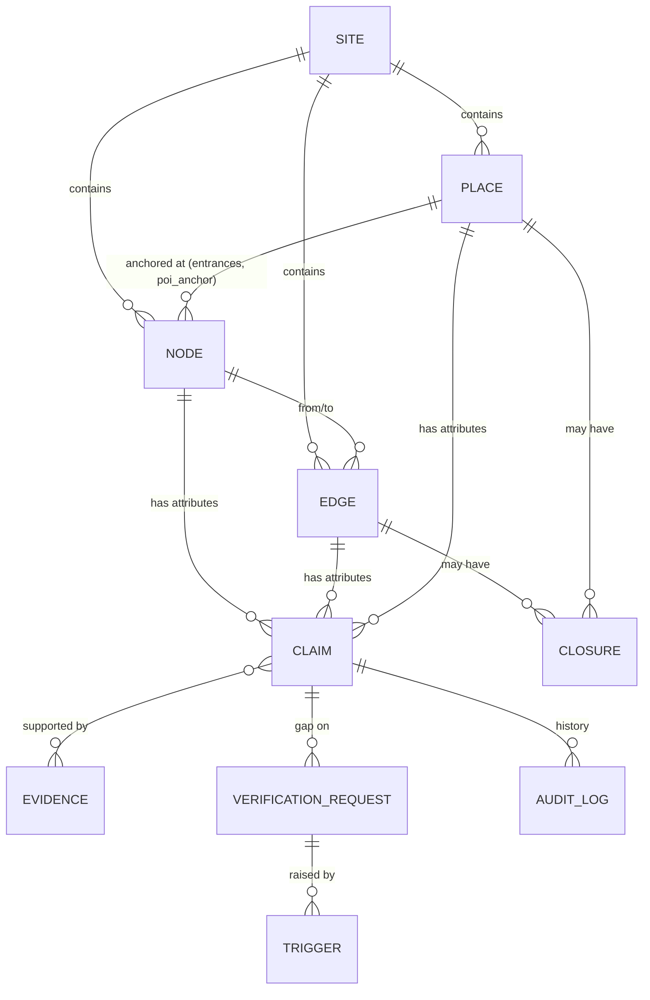

# World Model Schema & Routing Rules

> **The canonical spec** for the data the whole product stands on. Research and rationale: [../02-research/accessibility-and-routing.md](../02-research/accessibility-and-routing.md). Decisions: ADR [0003](../00-overview/decisions/0003-structured-world-model-is-source-of-truth.md) and [0004](../00-overview/decisions/0004-tri-state-accessibility-attributes.md). Owner: **Backend**. Changes go through a PR touching this file.

## 1. Design principles

1. **Extend, don't invent.** Geometry and attribute names follow **OpenSidewalks 0.3** and **OSM tags** wherever they exist, so a later import to or export from OSM or OpenSidewalks tooling is cheap.
2. **Unknown is a value.** Every accessibility-relevant attribute has a `status`, and `unknown` is never treated as passable.
3. **Facts carry provenance.** Each attribute value is a *claim* with source, method, who, when and TTL (W3C PROV-O-inspired, stored as plain columns).
4. **The graph is in WGS84.** Scene coordinates are the frontend's problem ([3d-pipeline.md](3d-pipeline.md)).
5. **The router never reads raw attributes directly.** It reads derived per-profile `PASS / FAIL / UNKNOWN` evaluations, so profile logic lives in one place.

## 2. Entities



### 2.1 Node (Point)
| Field | Type | Notes |
|---|---|---|
| `id` | str | `n-…`, `ent-…` for entrances |
| `type` | enum | `entrance`, `junction`, `curb_ramp`, `door`, `lift`, `parking_bay`, `drop_off`, `poi_anchor` |
| `geometry` | Point `[lon, lat]` | plus optional `level` (int, 0 = ground) and `ele_m` |
| `place_id` | str? | for entrances and anchors: which place they belong to |
| `name`, `aliases[]` | str | aliases include BM/中文 names and common nicknames ("dewan", "main gate") |

### 2.2 Edge (LineString)
| Field | Type | Notes |
|---|---|---|
| `id` | str | `seg-0001` |
| `type` | enum | `footway`, `sidewalk`, `crossing`, `steps`, `ramp`, `corridor`, `lift_ride`, `indoor_link`, `driveway_crossing`; the OSM import also emits `street`, `track`, `path`, `pedestrian` and `major_road` (OSM primary/secondary/trunk + links: walking profiles need a `sidewalk` claim: stroller, wheelchair and older_adult_rest need it **verified**, because a reported one is UNKNOWN like any reported hard-constraint value; default accepts reported. Missing → UNKNOWN. `sidewalk=none`, even if only reported, FAILs stroller, wheelchair and older_adult_rest) |
| `from`, `to` | node ids | edges are **bidirectional** unless `oneway=yes`; `incline_pct` is signed in the from→to direction |
| `geometry` | LineString | |
| `length_m` | float | computed from geometry (geodesic) and not editable |

### 2.3 Place
| Field | Type | Notes |
|---|---|---|
| `id` | str | `hall`, `toilet-01`, `bench-04`, `park-b` |
| `type` | enum | `facility`, `toilet`, `accessible_toilet`, `baby_change`, `seating`, `shelter`, `parking`, `oku_parking`, `drop_off`, `prayer_room`, `water`, `info_point`, `bus_stop` |
| `geometry` | Point or Polygon | |
| `name`, `aliases[]`, `description` | | |
| `entrance_ids[]` | | for facilities; one must be `main_accessible_entrance` (or the claim is `unknown`) |
| `opening_hours` | OSM `opening_hours` syntax | itself a claim with provenance |

### 2.4 Attribute catalogue (claims on nodes, edges and places)

| Key | Applies to | Value type | OSM / OpenSidewalks alignment |
|---|---|---|---|
| `step_count` | edge, entrance | int | `step_count` |
| `step_height_cm` | edge, entrance | float | `climb` (OpenSidewalks) |
| `incline_pct` | edge | float (max along the segment, signed) | `incline` |
| `width_m` | edge, door | float (min clear width) | `width` |
| `surface` | edge | enum: asphalt, concrete, paving_stones, tiles, gravel, grass, grating, metal | `surface` |
| `surface_condition` | edge | enum: good, uneven, obstructed | ours |
| `kerb` | node (crossing ends) | enum: flush, lowered, raised, rolled | `kerb` |
| `ramp` | edge, entrance | bool | `ramp` |
| `handrail` | edge | enum: both, one_side, none | `handrail` |
| `sidewalk` | edge (`major_road`) | enum: both, one_side, none, separate | `sidewalk`, `sidewalk:both/left/right` (normalised; no tag = no claim) |
| `tactile_paving` | edge, node | bool | `tactile_paving` |
| `shelter` | edge, place | enum: covered, partial, none | ours (`covered=*` in OSM) |
| `lit` | edge | bool | `lit` |
| `door_type` | entrance | enum: automatic, push, pull, sliding, revolving, none | `door=*` |
| `wheelchair` | place, entrance | enum: yes, limited, no | `wheelchair` |
| `seating_adjacent` | edge, place | bool | ours |
| `opening_hours` | place, entrance | string | `opening_hours` |

Add a new attribute = add a row here + a TTL in §3 + a field in the staff editor.

## 3. Claims (attribute values with provenance)

One row per `(entity_id, attribute)` *current* claim; superseded claims are kept for history.

| Field | Type | Notes |
|---|---|---|
| `entity_id`, `attribute` | | composite key for the current claim |
| `value` | JSON | `null` when the status is `unknown` |
| `status` | enum | `unknown` → `reported` → `verified` → `stale` / `contested` |
| `evidence_type` | enum | `staff_site_visit`, `staff_photo`, `sdp_document`, `osm_import`, `overture_import`, `resident_report`, `team_survey` (hackathon field visits), `llm_inferred` |
| `method` | enum | `tape`, `inclinometer`, `visual`, `count`, `document`, `import` |
| `evidence_ids[]` | | photos and documents |
| `verified_by`, `verified_at` | | only set when `status = verified` |
| `ttl_days` | int | default per attribute class (below) |
| `supersedes` | claim id | history chain |
| `notes` | str | |

**Status rules**
- Only authorised staff (or, during the hackathon, the team after a field visit) can set `verified`.
- `resident_report` and imports land as `reported` and are **never** treated as verified for hard constraints.
- `llm_inferred` values may be stored as suggestions but can **never** become `verified`, and are never used for routing.
- After `now > verified_at + ttl_days` the claim is read as `stale` (computed on read, not by a cron job).
- An open `resident_report` that contradicts a verified value marks it `contested` until resolved.

**Default TTLs** (team assumptions, revisit with SDP ops): closures 7 d · opening hours 90 d · seating/shelter 180 d · steps/ramps/kerbs/width/surface/sidewalk 365 d.

**Trust score** (display only, never used for routing): weight by `evidence_type` (site visit 1.0 · staff photo 0.8 · SDP document 0.5 · import 0.3 · resident report 0.2 · LLM 0.0) × linear freshness decay over the TTL.

## 4. Closures
`{ id, element_id, reason, from, to, source_type, created_by }`. An active closure makes the element **FAIL** for every profile and is cited in answers ("covered walkway closed for works until 20 Nov").

## 5. Profiles

Profile IDs are canonical across the API, the AI, the simulator and the UI.

| Profile ID | Persona | Hard constraints (FAIL if violated) | Soft costs (multipliers on length) |
|---|---|---|---|
| `default` | Daniel | active closure | stairs ×1.2 (slower) |
| `stroller` | Aisyah | `step_count = 0`; `kerb ∈ {flush, lowered}`; `width_m ≥ 0.8`; `incline_pct ≤ 8.3`; on `major_road`, a verified sidewalk (`no_sidewalk_is: FAIL`: `sidewalk=none` fails) | covered ×0.86; uneven surface ×1.5 |
| `wheelchair` | Priya | as stroller (including `no_sidewalk_is: FAIL`), plus `width_m ≥ 0.9`; `surface_condition ≠ obstructed`; level change only via `ramp` or `lift_ride` | incline > 5 % ×1.5; gravel/grass ×3 |
| `older_adult_rest` | Uncle Lim | `step_count = 0` (variant: ≤ 3 steps with a handrail); **longest rest-free run ≤ 100 m** (`frail` variant: 50 m); on `major_road`, a verified sidewalk (`no_sidewalk_is: FAIL`) | covered ×0.86; unlit ×1.3 after 19:00 |

> ⚠️ Thresholds are **engineering defaults**, not MS 1184 values: MS 1184 is paywalled and not yet verified. Say so if a judge asks, and ask mentors for review. Profiles live in versioned YAML under `packages/spatial/profiles/`.

### 5.1 Per-element evaluation

For each element and profile: `evaluate(element, profile, at) → PASS | FAIL | UNKNOWN`
- **FAIL** if any hard constraint is violated by a `verified` (or `reported`, for blocking evidence) value, or there is an active closure.
- **UNKNOWN** if a hard-constraint attribute is `unknown`, `stale`, `contested`, or only `reported`/imported.
- **PASS** otherwise.
- *Rationale:* a reported barrier is enough to avoid an edge, but a reported "no barrier" is not enough to promise one.

## 6. Routing algorithm

1. **Resolve endpoints.** `from`/`to` place → candidate nodes (all entrances of a facility; all bays of a car park). Multi-source/multi-target Dijkstra picks the best pair, so the engine chooses **which entrance**. That is the core of the "which entrance should I use?" question.
2. **Strict pass:** Dijkstra over PASS edges only, weight = `length_m × soft multipliers`.
   - `older_adult_rest` uses a **resource-constrained** search over the state `(node, metres_since_rest)`. Entering a node with seating (`seating_adjacent=yes` or a `seating` place within 10 m) resets the counter; transitions over the limit are pruned.
3. **Lenient pass** (only if strict fails, or to offer a shorter alternative): PASS + UNKNOWN edges, with UNKNOWN weight × **5**.
4. **Classify:**

| Route status | Condition | Answer phrasing |
|---|---|---|
| `confirmed` | strict pass found a route | "Confirmed step-free route…" |
| `partly_unverified` | only the lenient pass found a route | "Possible route, but N segment(s) unverified: …" + VR(s) |
| `blocked` | neither pass found a route | "No step-free route found in verified data; blocked at …" |
| `no_data` | an endpoint couldn't be resolved, or the place isn't modelled | "I don't have that place yet" + VR |

5. **Return:** the route, `unknowns[]` (element, attribute, why it matters for this profile), `blocked_alternatives[]`, `rest_points[]`, `max_gap_between_rest_m`, `evidence_ids[]` (see [api-contract](api-contract.md)).
6. **Gap side-effect:** each UNKNOWN element on a returned `partly_unverified` route triggers `create_verification_request` (deduped, demand+1).

### 6.1 Gap impact ranking (for the staff queue and the simulator)
For each UNKNOWN element `e`: `impact(e)` = the number of (profile, task) pairs that would change from `partly_unverified`/`blocked` to `confirmed` if `e` were PASS. Computed by flip-and-reroute (cheap at about 500 edges). The VR queue sorts by `impact × (1 + log(1 + demand))`.

## 7. Storage

- **DB tables:** `sites, nodes, edges, places, claims, evidence, closures, verification_requests, vr_triggers, audit_log, question_log, sim_runs, sim_results`.
- **Load path:** DB → `packages/spatial/graph.py` builds a NetworkX `MultiDiGraph` (two directed edges per bidirectional edge, with the incline sign flipped) and caches it. It rebuilds on any claim or closure write (version counter).
- **Interchange:** GeoJSON FeatureCollections (`/graph`, seed files in `data/seed/*.geojson`) that validate against a **fork of the OpenSidewalks JSON Schema** extended with our `claims` block.
- **Seed workflow:** OSM/Overture import → `reported` claims (`evidence_type=osm_import`) → field visit → `verified`.

## 8. Example edge (GeoJSON feature)

```json
{
  "type": "Feature",
  "id": "seg-0042",
  "geometry": { "type": "LineString", "coordinates": [[101.5321, 3.1210], [101.5323, 3.1212]] },
  "properties": {
    "kind": "segment", "type": "ramp", "from": "n-017", "to": "ent-hall-side",
    "length_m": 14.2,
    "claims": {
      "step_count":  { "value": 0,    "status": "verified", "evidence_type": "team_survey", "method": "count",
                       "verified_by": "team:JQ", "verified_at": "2026-10-18", "ttl_days": 365, "evidence_ids": ["ev-019"] },
      "incline_pct": { "value": null, "status": "unknown" },
      "width_m":     { "value": 1.4,  "status": "verified", "method": "tape", "verified_at": "2026-10-18", "evidence_ids": ["ev-020"] },
      "shelter":     { "value": "partial", "status": "reported", "evidence_type": "resident_report" }
    }
  }
}
```
For `stroller`, this edge evaluates **UNKNOWN** (the incline is unknown). Any route through it is at best `partly_unverified`, and a VR "verify `incline_pct` on seg-0042" is raised.

## 9. Tests the backend must have (minimum)
- Fixture graph `tiny_site.geojson` with: one confirmed route, one route only via an unknown ramp, one blocked by steps, one closure, a rest-gap > 100 m, a stale claim and a contested claim.
- One test per row of the classification table, for each profile.
- Property tests (Hypothesis): monotonicity (relaxing a constraint never removes a route; adding a verified blocker never creates one) and "no FAIL edge ever appears in a returned route".

---

## 10. Township scale: base twin, lenses and scenarios (added 15 Oct 2026, ADRs 0009/0010)

§1–9 define the **access** lens at the deep spot. At township scale, the world model is a **base twin plus lens overlays** that share IDs and provenance fields. Data research: [township-3d-engine-and-data § 4](../02-research/township-3d-engine-and-data.md).

### 10.1 Layers

| Layer | Contents | Source (MVP) | Format |
|---|---|---|---|
| **Base: boundary** | Elmina polygon (envelope `3.150,101.460,3.240,101.530`, clipped) | OSM `landuse`/names, or the SDP master plan if provided | GeoJSON |
| **Base: buildings** | Footprints (about 7k OSM / 22k Overture in the envelope); heights mostly absent | OSM + Overture (2026-09 release) | GeoParquet → GeoJSON per area |
| **Base: terrain** | Copernicus GLO-30 DEM (EGM2008) + derived HAND | Copernicus / ASF HAND (CC0) | COG GeoTIFF (build-time only) |
| **Base: hydrology** | Rivers, streams, drains, ponds, retention basins, pumping stations | OSM (123 waterway features, 83 water bodies) | GeoJSON |
| **Base: walk network** | Footways, paths, crossings, steps (whole envelope, `reported`), with deep-spot claims verified | OSM import + field survey | GeoJSON → NetworkX |
| **Base: drive network** | Roads (residential, service, primary…) | OSM via OSMnx | GraphML/GeoJSON → NetworkX |
| **Base: places** | Facilities, schools, halls, places of worship, clinics, parks, playgrounds, toilets, shelters | OSM + hand-curated | GeoJSON |
| **Lens `access`** | Claims on walk edges, nodes, entrances (§2–3) | Survey + import | GeoJSON + SQLite claims |
| **Lens `flood`** | Scenarios, water polygons, per-edge/per-place flood class, evacuation centres | HAND pipeline + OSM candidates + official PPS evidence | GeoJSON + JSON |
| **Lens `waste`** | 20–40 hand-curated recycling / e-waste / bin points with status | Field + MBSA / SWCorp pages | GeoJSON |

**Common feature fields:** `id, lens, kind, geometry, name, status, source, source_url, valid_from, valid_to, evidence_ids`.

### 10.2 Flood scenario entities

```
Scenario        { id: "stage_p3m", stage_m: 3, method: "HAND", dem: "GLO-30", margin_m: 1.0,
                  created, evidence_ids, disclaimer }
ScenarioWater   { scenario_id, polygon (WGS84), surface_height_m (ellipsoidal, for the renderer),
                  depth_band: "0-0.5|0.5-1|>1" (display only) }
ScenarioEdge    { scenario_id, edge_id, flood_class: likely_flooded|possible|unlikely, hand_min_m, hand_mean_m }
ScenarioPlace   { scenario_id, place_id, flood_class, cut_off: bool }
EvacCentre      { id: "evc-…"|"pps-…", place_id, source: official_pps|osm_candidate, capacity?, evidence_ids }
```

**Classification** (per scenario `s`, edge `e`, with `stage = s.stage_m` and margin `M`):
- `likely_flooded` if `hand_min(e) < stage − M`
- `possible` if `hand_min(e) < stage + M`
- `unlikely` otherwise

Only cells **connected** to the drainage network count (no isolated hollows).

### 10.3 Evaluation with a scenario (extends §5.1)

```
evaluate(e, profile, at, scenario):
  if scenario and flood_class(e, scenario) == likely_flooded and profile.depth_fail_applies: FAIL
  if scenario and flood_class(e, scenario) == possible: min(UNKNOWN, base)   # never upgrades
  else: base = evaluate(e, profile, at)   # §5.1 rules
```

Flood depth thresholds per profile (`config/profiles/*.yaml`, shown in the UI legend): wheelchair/stroller are the strictest (engineering default, **unsourced**); pedestrians use UK FD2320-style danger bands; `drive` uses about 0.3 m. With a 30 m DEM we never compute path-level depth. The three classes plus the margin encode that uncertainty.

**Invariant:** for stages `s1 < s2`, the flooded set at `s1` ⊆ the flooded set at `s2`, and a higher stage never un-floods an edge (property test).

### 10.4 Evacuation analytics (per scenario × profile)
- **Reachability:** multi-source Dijkstra from residential nodes over PASS edges → reachable centres, distance/time.
- **Islands:** connected components with no PASS path to any centre → `isolated_components`.
- **Isochrones:** 5/10/15-minute reach from each centre (`single_source_dijkstra_path_length` with a cutoff).
- **Baseline vs scenario delta** = the management briefing.

### 10.5 Storage (MVP)
Versioned GeoJSON/GeoParquet in `data/` (build outputs committed when small, otherwise rebuilt by script) + in-memory Shapely STRtree + NetworkX graphs (walk, drive) + **SQLite** for claims, VRs, the question log and sim runs. **No PostGIS for the MVP.** DuckDB-spatial at build time only. PMTiles only for the Mapbox lite view.
