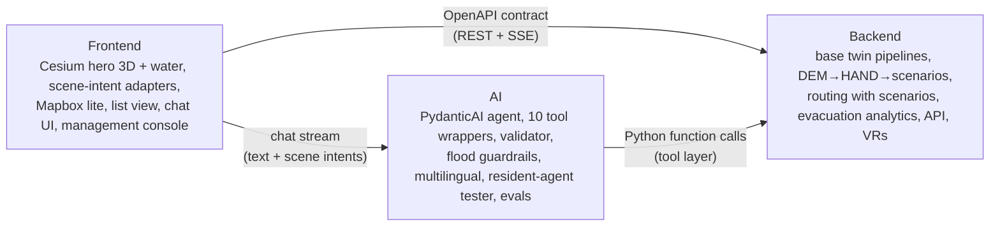

# Team Roles & Ownership

Three people, three lanes, and one shared contract. Each lane can build and demo independently against **mocks** of the other two. That is what lets a 3-person team move fast.

| Lane | Owner | Backup reviewer |
|---|---|---|
| Backend (BE) | _name_ | AI |
| Frontend (FE) | _name_ | BE |
| AI | _name_ | FE |
| **Shared:** pitch, research, field verification | everyone (pitch lead: _name_) | |

> Fill in names in the first team meeting. The **team leader** (the person who submits on the portal) is: _name_.
> Updated 15 Oct 2026 for the Township World Model platform ([ADR 0009](../00-overview/decisions/0009-township-world-model-platform.md)): one shared **base twin** of City of Elmina, with **lenses** on top (`access` deep, `flood` deep, `waste` thin). Canonical names: [../04-architecture/README.md](../04-architecture/README.md).

## Who does what, per lens

| Lens | Backend | Frontend | AI |
|---|---|---|---|
| **Base twin** (shared) | OSM/Overture import, OSMnx road and walk graphs, DEM (Copernicus GLO-30), places and evacuation-centre candidates, files + SQLite | Cesium hero over Google photoreal tiles, camera, layer toggles, Mapbox lite, list view | Place aliases (EN/BM/中文) for `find_place`, golden questions on place lookup |
| **`access`** (deep) | Tri-state claims, routing with profiles (`default`, `stroller`, `wheelchair`, `older_adult_rest`), route status, VR workflow, seed data for the deep spot | Route highlight (`route.highlight`), evidence cards, uncertainty badges, VR queue and attribute editor | `plan_route`, `get_place_details`, `nearby_amenities`, `get_closures`, `create_verification_request` wrappers, VR-trigger logic, access golden set |
| **`flood`** (deep) | GLO-30 → HAND → `baseline`, `stage_p1m … stage_p5m`; per-edge `flood_class`; `drive` profile; `plan_route(scenario_id)`; reachability, islands, isochrones; monotonicity tests | Water as translucent extruded polygons at absolute height (`flood.set_level`), scenario bar, edge colouring and stripes for UNKNOWN, "why this edge?" popover, management flood briefing | `list_flood_scenarios`, `affected_places`, `list_evacuation_centres` wrappers; flood guardrails and disclaimers (never "safe", never exact depths, always "indicative"); flood golden set; BM/中文 |
| **`waste`** (thin) | 20–40 hand-curated waste and recycling points as an overlay (`wp-` IDs), status unknown/verified | Layer toggle (`layer.toggle`), pins | `find_waste_points` wrapper, 3 golden questions |

---

## Backend (BE): "the truth layer"

**Mission:** make the base twin and every lens overlay correct, queryable and editable, and make routes and scenarios provably right.

**Owns**
- The world-model schema and files + SQLite store ([../04-architecture/world-model-schema.md](../04-architecture/world-model-schema.md), incl. § 10 lenses and scenarios).
- **Base twin pipelines** (`data/scripts/`): OSM and Overture import, OSMnx road and walk graphs, the candidate evacuation-centre and waste-point lists, evidence photo storage.
- **Flood pipeline:** Copernicus GLO-30 DEM → HAND (ASF raster first, then pysheds) → precomputed scenarios → per-edge and per-place status, with versioned depth-threshold YAML ([ADR 0010](../00-overview/decisions/0010-flood-lens-hand-scenarios.md)). Datum offset documented for the FE.
- **Routing engine:** profiles including `drive`, tri-state handling, route classification (`confirmed` / `partly_unverified` / `blocked` / `no_data`), and **routing with scenarios** (a scenario can only add FAIL/UNKNOWN, never PASS).
- **Evacuation analytics:** reachable `official_pps` / `osm_candidate` centres per profile and scenario, isolated islands, isochrones.
- The REST API and OpenAPI spec ([../04-architecture/api-contract.md](../04-architecture/api-contract.md)).
- The verification-request (VR) workflow: create, dedupe/upvote, assign, resolve, audit log.
- Seed data and fixtures for tests (cover `unknown` cases and every scenario).

**Definition of done for BE features:** an endpoint is in the OpenAPI spec, has a pytest test, uses fixtures that cover the `unknown` cases, and is deployed. Flood features also need the monotonicity test (a higher stage never un-floods an edge).

**Key skills to read up on:** NetworkX shortest paths with custom weights, GeoJSON/GeoParquet, rasterio, pysheds (HAND), OSMnx, Pydantic v2, FastAPI, SQLAlchemy + SQLite, pyproj.

---

## Frontend (FE): "the experience layer"

**Mission:** make the answer *visible*. A resident should understand a route and its uncertainties in 5 seconds; a manager should see "what if it floods tonight" in one drag of a slider.

**Owns**
- **Cesium hero:** CesiumJS + Resium over Google Photorealistic 3D Tiles, with credits on screen ([ADR 0007](../00-overview/decisions/0007-3d-engine-cesium.md), [../04-architecture/3d-pipeline.md](../04-architecture/3d-pipeline.md)); lazy-loaded, mobile tuned; Cesium OSM Buildings fallback switch.
- **Water:** translucent extruded polygon per scenario at absolute height, depth-tested against the photoreal mesh; datum calibration against the Elmina lake surface.
- **Scene-intent adapters:** one per renderer (Cesium, Mapbox lite, list text) for `camera.fly_to`, `place.focus`, `route.highlight`, `flood.set_level`, `layer.toggle`.
- **Mapbox lite** 2.5D view and the **list / text view** (screen-reader path, default on low-power devices).
- The chat UI: streaming text, evidence cards (photo, source, date), uncertainty and disclaimer rendering (the `uncertainty` and `disclaimer` events).
- The **management console:** VR queue, attribute editor with evidence upload, flood briefing (cut-off places, islands, pre-position table, print view), recurring-questions view, gap map, persona-run report.
- The web UI's own accessibility (WCAG 2.2 AA basics: keyboard, contrast, focus, ARIA live region for chat).
- Demo polish: loading states, mobile layout, the demo-script happy path.

**Definition of done:** works on a mid-range Android phone in Chrome (with the Lite view as the escape hatch), is keyboard-navigable, has no console errors, and is deployed.

**Key skills to read up on:** CesiumJS (Entity, Primitive, clipping, `createGooglePhotorealistic3DTileset`) + Resium, Mapbox GL JS (`react-map-gl/mapbox`), Tailwind/shadcn, SSE streaming. Use `npx ctx7@latest docs` for current Cesium and Resium APIs.

---

## AI: "the reasoning and language layer"

**Mission:** turn natural-language questions into the right tool calls, and tool results into honest, clear, cited answers. Never make things up, and never reassure about floods.

**Owns**
- **The PydanticAI agent** (`packages/agent`, [ADR 0008](../00-overview/decisions/0008-agent-harness-pydantic-ai.md)): OpenRouter model from env, `output_type=FinalAnswer`, the output validator with retries and a template fallback, the SSE event mapper, and the mock provider for CI. See [../04-architecture/ai-assistant-design.md](../04-architecture/ai-assistant-design.md).
- **The 10 tool wrappers:** thin PydanticAI tools over BE's `packages/spatial/tools.py` (`find_place`, `get_place_details`, `plan_route`, `nearby_amenities`, `get_closures`, `create_verification_request`, `list_flood_scenarios`, `affected_places`, `list_evacuation_centres`, `find_waste_points`). BE owns the functions, AI owns descriptions and schemas via a PR that BE reviews.
- **The validator:** citation requirement, abstention rules, VR-trigger logic.
- **Flood guardrails and disclaimers:** the disclaimer always comes from the tool result, never "safe", no invented depths, official links (MBSA, JPS, NADMA) shown, scenario provenance cited.
- **Multilingual:** EN / BM / 中文 / Manglish spot-checks, in both lenses.
- **Resident-agent tester**, including flood: persona definitions, task generation, the batch runner, the flood invariants (per scenario × profile), failure explanations and the gap report. See [../04-architecture/resident-agents-design.md](../04-architecture/resident-agents-design.md).
- **Evals:** the golden question set (access, flood, waste), tool-call accuracy, unsupported-claim rate, "no safe claims" checks, and a CI regression run with `LLM_PROVIDER=mock`. See [../03-product/evaluation-plan.md](../03-product/evaluation-plan.md).
- Prompt and cost budget (stays within OpenRouter credits; cheap default model, escalate model only on retry).

**Definition of done:** the golden-set score doesn't regress, the unsupported-claim rate is 0 on the golden set, flood answers always carry the disclaimer, and every new tool has at least 3 golden questions.

**Key skills to read up on:** PydanticAI (`output_validator`, `ModelRetry`, `run_stream_events`, `FunctionModel`/`TestModel`), OpenRouter, structured outputs, Promptfoo/pytest eval patterns.

---

## Shared responsibilities (everyone)

| Activity | How |
|---|---|
| **Field verification** | At least one site visit to photograph entrances, paths, toilets and benches, and to record attributes with timestamps; if possible also photograph drains, ponds and flood marks near the river corridor (to sanity-check scenarios). Go as a pair. Avoid photographing people (blur faces if unavoidable). See [../03-product/field-verification-guide.md](../03-product/field-verification-guide.md). |
| **User testing** | Each person runs 2 or more short sessions with real users (ideally a parent with a stroller, an older adult, and a wheelchair user if possible). Get consent first. |
| **Pitch** | Each person presents their lane's "Enabler" slide. One person presents the Mechanism story. |
| **Docs** | Update the relevant doc in the same PR as the code change. Record decisions as ADRs. |

## Working agreements

1. **Push small and often to `main`** (trunk-based). Keep `main` deployable. Hide incomplete UI behind flags. Details: [dev-setup.md](dev-setup.md).
2. **The contract comes first.** Change `api-contract.md` / OpenAPI *before* changing the code that depends on it, and tell the other two in chat.
3. **Daily async stand-up** in the group chat by 10am: *yesterday / today / blocked*.
4. **Two syncs a week** (30 min): Mon (plan) and Thu (demo to each other).
5. **Blocked for more than 2 hours?** Ask. Decide by 2-of-3 vote when stuck; the lane owner breaks ties within their lane.
6. **No secrets in git.** API keys go in `.env` only.
