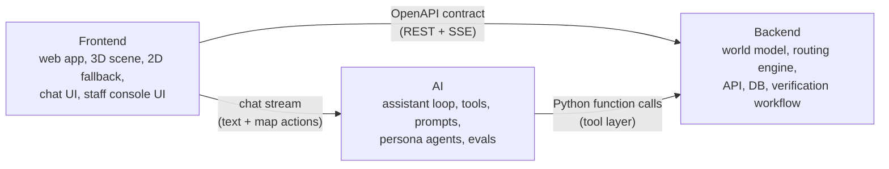

# Team Roles & Ownership

Three people, three lanes, and one shared contract. Each lane can build and demo independently against **mocks** of the other two. That is what lets a 3-person team move fast.

| Lane | Owner | Backup reviewer |
|---|---|---|
| Backend (BE) | _name_ | AI |
| Frontend (FE) | _name_ | BE |
| AI | _name_ | FE |
| **Shared:** pitch, research, field verification | everyone (pitch lead: _name_) | |

> Fill in names in the first team meeting. The **team leader** (the person who submits on the portal) is: _name_.

---

## Backend (BE): "the truth layer"

**Mission:** make the world model correct, queryable and editable, and make routes provably right.

**Owns**
- The world-model schema and DB ([../04-architecture/world-model-schema.md](../04-architecture/world-model-schema.md)).
- Data ingestion: OSM/Overture import → clean → our graph; manual entry of verified attributes; evidence photo storage.
- The routing engine: profiles, tri-state handling, route classification (confirmed / partly unverified / blocked / no data).
- The REST API and OpenAPI spec ([../04-architecture/api-contract.md](../04-architecture/api-contract.md)).
- The verification-request workflow: create, dedupe/upvote, assign, resolve, and write the audit log.
- Seed data for the MVP site plus fixtures for tests.

**Definition of done for BE features:** an endpoint is in the OpenAPI spec, has a pytest test, uses fixtures that cover the `unknown` cases, and is deployed.

**Key skills to read up on:** NetworkX shortest paths with custom weight functions, GeoJSON, Pydantic v2, FastAPI, SQLModel/Postgres, pyproj.

---

## Frontend (FE): "the experience layer"

**Mission:** make the answer *visible*. A resident should understand a route and its uncertainties in 5 seconds.

**Owns**
- The 3D scene: the base 3D data plus our overlay (paths coloured by status, entrance markers, amenity pins, route highlight, camera fly-to). See [../04-architecture/3d-pipeline.md](../04-architecture/3d-pipeline.md).
- The 2D fallback map, and a text/list mode that screen readers can use.
- The chat UI: streaming text, rendering of **map actions**, evidence cards (photo, source, verified date) and uncertainty badges.
- The staff console UI: VR queue, attribute editor with evidence upload, recurring-questions view, gap map.
- The persona-run report UI (simulation results).
- The web UI's own accessibility (WCAG 2.2 AA basics: keyboard, contrast, focus, ARIA live region for chat).
- Demo polish: loading states, mobile layout, the demo-script happy path.

**Definition of done:** works on a mid-range Android phone in Chrome, is keyboard-navigable, has no console errors, and is deployed.

**Key skills to read up on:** React Three Fiber + drei, 3d-tiles-renderer or CesiumJS (per [stack-decision](../04-architecture/stack-decision.md)), MapLibre, Tailwind/shadcn, SSE streaming.

---

## AI: "the reasoning and language layer"

**Mission:** turn natural-language questions into the right tool calls, and tool results into honest, clear, cited answers. Never make things up.

**Owns**
- The assistant loop: model choice, the tool definitions that wrap BE functions, the system prompt, streaming, and the answer format (text + map actions + evidence + uncertainty). See [../04-architecture/ai-assistant-design.md](../04-architecture/ai-assistant-design.md).
- Grounding guardrails: the citation requirement, abstention rules, and VR-trigger logic.
- Resident-agent simulation: persona definitions, task generation, the batch runner, failure explanations and the gap report. See [../04-architecture/resident-agents-design.md](../04-architecture/resident-agents-design.md).
- Evals: the golden question set, tool-call accuracy, unsupported-claim rate, a multilingual spot-check, and a regression run in CI. See [../03-product/evaluation-plan.md](../03-product/evaluation-plan.md).
- Prompt and cost budget (stays within free tiers or credits).

**Definition of done:** the golden-set score doesn't regress, the unsupported-claim rate is 0 on the golden set, and every new tool has at least 3 golden questions.

**Key skills to read up on:** the LLM tool-use API of the chosen provider, structured outputs, eval tooling, prompt caching.

---

## Shared responsibilities (everyone)

| Activity | How |
|---|---|
| **Field verification** | At least one site visit to photograph entrances, paths, toilets and benches, and to record attributes with timestamps. Go as a pair. Avoid photographing people (blur faces if unavoidable). See [../03-product/field-verification-guide.md](../03-product/field-verification-guide.md). |
| **User testing** | Each person runs 2 or more short sessions with real users (ideally a parent with a stroller, an older adult, and a wheelchair user if possible). Get consent first. |
| **Pitch** | Each person presents their lane's "Enabler" slide. One person presents the Mechanism story. |
| **Docs** | Update the relevant doc in the same PR as the code change. Record decisions as ADRs. |

## Working agreements

1. **Push small and often to `main`** (trunk-based). Keep `main` deployable. Hide incomplete UI behind flags. Details: [dev-setup.md](dev-setup.md).
2. **The contract comes first.** Change `api-contract.md` / OpenAPI *before* changing the code that depends on it, and tell the other two in chat.
3. **Daily async stand-up** in the group chat by 10am: *yesterday / today / blocked*.
4. **Two syncs a week** (30 min): Mon (plan) and Thu (demo to each other).
5. **Blocked for more than 2 hours?** Ask. Decide by 2-of-3 vote when stuck; the lane owner breaks ties within their lane.
6. **No secrets in git.** API keys go in `.env` only.
