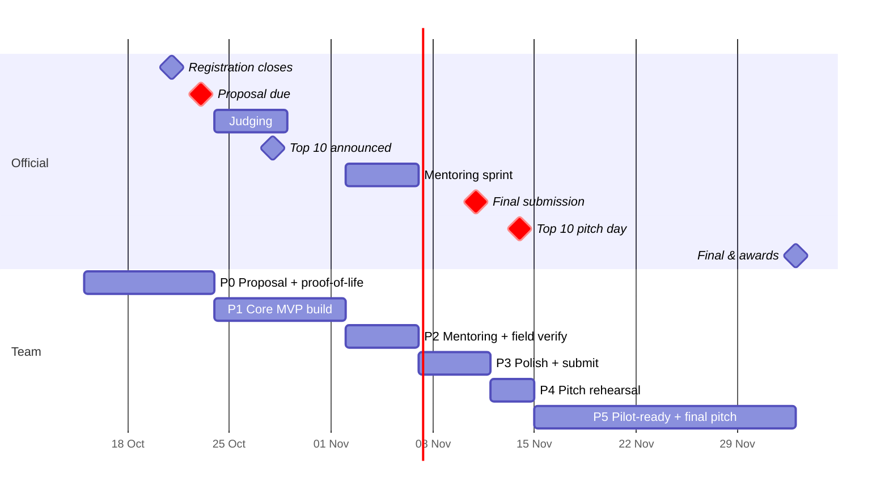

# Timeline & Milestones

> Re-planned **Thu 15 Oct 2026** for the Township World Model platform ([ADR 0009](../00-overview/decisions/0009-township-world-model-platform.md), engine [0007](../00-overview/decisions/0007-3d-engine-cesium.md), harness [0008](../00-overview/decisions/0008-agent-harness-pydantic-ai.md), flood [0010](../00-overview/decisions/0010-flood-lens-hand-scenarios.md)). Official dates are in [../01-hackathon/hackathon-brief.md](../01-hackathon/hackathon-brief.md).
> Planning rule: **always have a working demo by Friday.** Each phase ends with something we could show a judge.
> The flood research's four-week split ([flood-disaster-lens § 8.6](../02-research/flood-disaster-lens.md)) is merged with the access-lens work below: flood week 1 = P0, week 2 = P1 first half, week 3 = P1 second half plus P2, week 4 = P3.

---

## P0: Proposal + proof-of-life (Thu 15 Oct → Fri 23 Oct)

**Goal:** submit a strong proposal **with a proof-of-life: a screenshot or short video of Cesium over Elmina, one route, and one flood scenario**. A working platform spike at proposal stage is rare, and it scores on *Feasibility* (20%) and *Team/Evidence* (10%).

**Proof-of-life checklist (all three on one screen by Wed 21):**
1. **Cesium Elmina:** Cesium + Resium viewer with Google photoreal tiles centred on Elmina, credits visible (Day-1 spike also checks tile quality and a mid-range Android phone; fallback is Cesium OSM Buildings).
2. **One route:** `plan_route` for `wheelchair` or `stroller` between two real Elmina places, drawn on the scene, with at least one `unknown` flagged.
3. **One flood scenario:** `stage_p3m` (from the ASF HAND raster, clipped to the analysis area) as water at height `h`, with at least one road/path coloured by `flood_class`.

| Date | Everyone | BE | FE | AI |
|---|---|---|---|---|
| Thu 15 | Kick-off sync: confirm the pivot, stack (ADRs 0007–0010) and roles. **All members register on the portal.** Read `docs/` (start at README) | Repo scaffold (`apps/api`, `packages/spatial`); `import_osm.py` for the Elmina envelope; fetch GLO-30 + ASF HAND tile (N03 E101) | Repo scaffold (`apps/web`); **Day-1 Cesium spike:** Google tiles over Elmina, credits, mobile test | Pick OpenRouter models (env), get key/credits, `LLM_PROVIDER=mock`, first 15 golden questions (access + flood) |
| Fri 16 | | OSMnx walk + drive graphs; candidate evacuation centres (`osm_candidate`); validate DEM against SRTM samples | Water polygon prototype at height `h` + slider; datum offset test at the Elmina lake | PydanticAI skeleton with `FinalAnswer` + validator; 2 tools (`find_place`, `plan_route`) against BE mocks |
| Sat–Sun 17–18 | **Optional site visit** (pair): photos and attributes for main entrances and one route; photos of ponds/drains if possible | | | |
| Mon 19 | Sync: is the three-part proof-of-life on track? | Graph v0 hand-annotated for the deep spot (30 nodes / 50 edges, all `unknown` unless sourced); `plan_route` with profiles + status | Route highlight (`route.highlight`) on Cesium; chat panel | System prompt v1, answer format, abstain rule, flood disclaimer policy |
| Tue 20 | | HAND clip to the analysis area; `baseline` + `stage_p3m` GeoJSON; `flood_class` on edges (pysheds recompute starts in P1) | `flood.set_level` wired to a scenario; roads recoloured by class | Tool schemas for `list_flood_scenarios`, `affected_places`, `list_evacuation_centres`; run golden set v0 |
| Wed 21 | **Registration closes. Team leader bundles the team; every member accepts the invite.** Proposal draft v1 ([../06-pitch/proposal-outline.md](../06-pitch/proposal-outline.md)) | Deploy API (Cloud Run, Singapore) | Deploy web (Cloudflare Pages); record the 60–90 s **proof-of-life video** | |
| Thu 22 | Proposal review against the [judging mapping](../01-hackathon/judging-criteria-mapping.md); every flood statement checked for "indicative" wording | | Screenshots (3D Elmina, route, flood scenario) for the proposal | Eval numbers for the proposal (even small ones) |
| **Fri 23** | **Submit the proposal before noon** (leave a buffer for portal issues) | | | |

**Exit criteria:** proposal submitted with the proof-of-life screenshot/video; a deployed URL showing Cesium Elmina, where one question ("stroller route from the Lakeside Mall car park to the Urban Park playground") returns a highlighted route with at least one `unknown` flagged, and where `stage_p3m` shows water and recoloured roads.

---

## P1: Platform build (Sat 24 Oct → Sun 1 Nov), during judging

Keep building whatever the result. It costs nothing, and if we're Top 10 we start the mentoring sprint already ahead. This phase merges flood weeks 2 and the first half of week 3 with the access-lens build.

| Lane | Deliverables |
|---|---|
| BE | **Flood:** pysheds HAND recompute, all six scenarios (`baseline`, `stage_p1m … stage_p5m`), edge/place classification, scenario API, `plan_route(scenario_id)`, `drive` profile; start evacuation reachability, islands and isochrones. **Access:** full tri-state schema + SQLite store, all 10 tools as functions + REST, VR workflow (create/dedupe/resolve), evidence upload, closures; 80% test coverage on routing; Hypothesis monotonicity test |
| FE | **Flood:** scenario bar + legend + stripe pattern for UNKNOWN, "why this edge?" popover, cut-off badges. **Access/platform:** evidence cards, uncertainty badges, Mapbox lite view + list mode, layer toggles (`access`, `flood`, `waste`), management console v1 (VR queue + attribute editor), mobile layout |
| AI | All 10 tools wired; `affected_places` and `list_evacuation_centres` in answers; VR auto-trigger; flood guardrails (no "safe", disclaimer, official links); multilingual check (BM/中文); resident-agent tester v1 (3 profiles × 10 tasks, access); golden set grows to about 50 questions; CI eval run with the mock provider |
| All | **Wed 28 Oct: Top 10 announcement.** Prepare 5 questions to ask mentors (list in [hackathon-brief](../01-hackathon/hackathon-brief.md#open-questions-to-ask-organisers--mentors)); send the data requests (boundary polygon, PPS list, LiDAR/drainage) today |

## P2: Mentoring sprint + field verification (Mon 2 → Fri 6 Nov)

- Present the current demo to mentors on day 1, then log all feedback as issues. **Flood wording gets a mentor/SDP comms check this week.**
- **Field verification visit**: verify every attribute on the demo routes, attach evidence photos, set `verified_at`. If SDP or mentors supply flood marks or photos (Oct 2024 / Apr 2025), compare them with `stage_*` footprints near Kampung Kubu Gajah and the river corridor, and note the mismatch honestly.
- **BE:** evacuation reachability, islands and isochrones finished and tested; calibration notes; performance (GeoJSON size, API latency).
- **FE:** management flood briefing (cut-off list, islands, pre-position table, print view), resident "route to a safe place" flow, Cesium mobile tuning.
- **AI:** resident-agent tester under flood: invariants per scenario × profile ([resident-agents-design](../04-architecture/resident-agents-design.md) § 3.3b); evals for "no safe claims", scenario provenance, unknown handling.
- **User testing**: 4–6 short sessions comparing TownshipLens with a "Google Maps + FAQ page" baseline (protocol in [../03-product/evaluation-plan.md](../03-product/evaluation-plan.md)); at least one township/ops person reviews the flood lens.
- Close the loop live: one gap found in testing → VR → staff fix → better answer **and a re-run scenario**. **Record this. It is the core of the pitch.**

## P3: Polish + final submission (Sat 7 → Wed 11 Nov)

- Freeze features on Sun 8 Nov. After that, only bug fixes and polish (flood week 4: calibration, performance, demo choreography, accessibility of the UI itself, persona runs under flood).
- Final eval run; put the numbers into the deck.
- Demo video (2–3 min, includes the 60–90 s flood moment), deck, final docs, README with a live URL.
- **Submit the final on Tue 10 Nov** (one day of buffer).

## P4: Pitch rehearsal (Thu 12 → Sat 14 Nov)

- At least 5 full rehearsals with a timer, plus a judge Q&A drill ([../06-pitch/judge-qa.md](../06-pitch/judge-qa.md)) including "is the flood map a forecast?" and "why doesn't Elmina flood?".
- Back-up plan: offline recording of the demo (Cesium + water), in case the venue Wi-Fi, Google tiles or the LLM API fails; Lite view and list view as live fallbacks.

## P5: If we advance (15 Nov → 3 Dec)

- Turn mentor feedback into a **pilot proposal**: a 4–8 week pilot with KPIs, cost and data-governance plan ([../06-pitch/business-case.md](../06-pitch/business-case.md)): Lens 1 at one facility, Lens 2 as an ops planning tool using SDP LiDAR and drainage data (upgrade path: SFINCS-class 2D modelling).
- Extend to a second facility or a second township to *prove* scalability (onboarding time is the KPI). Data-centre siting stays a **roadmap slide** only (SHIFT32), not a build.

---

## Risk calendar

| Risk | When it bites | Mitigation |
|---|---|---|
| Not every member accepts the portal invite | 21–23 Oct | Do it on **Wed 21**, not Fri |
| Site visit blocked (weather, permission) | P0/P2 | Use Street View + public photos for v0 data and keep it marked `unverified` (that is honest and fits our story) |
| 3D data licence issue | any time | The 2D fallback is always working; the 3D layer can be swapped |
| LLM API outage or quota at demo | 14 Nov | Cached demo responses + recorded video |
| Scope creep | P1 | Anything not in [../03-product/mvp-spec.md](../03-product/mvp-spec.md) goes to the "later" list |
| (Pivot) Cesium + Google tiles look poor over Elmina, or billing/quota blocks them | Day 1 (15 Oct) | Day-1 spike decides; switch to Cesium OSM Buildings (config) or Mapbox lite; cap quota and set budget alerts |
| Heavy Cesium bundle on a mid-range phone | P1–P3 | Lazy-load, `requestRenderMode`, Lite view button, list view default on low power |
| Datum mismatch (DEM EGM2008 vs ellipsoidal tiles): water floats or sinks | P0 | One calibrated offset against the Elmina lake surface; document it; verify at ponds |
| Misleading or "dramatic" flood in a high-relief township; false reassurance | P0–P4 | Stage scenarios only; Kampung Kubu Gajah / Paya Jaras downstream story; "indicative, never safe" in every answer; SDP comms review |
| Official data never arrives (boundary, PPS list, LiDAR, drainage, JPS) | P1–P2 | Nothing in the MVP depends on it: OSM candidates labelled `osm_candidate`, HAND from open DEM; ask early (28 Oct) |
| Two deep lenses plus a platform is too much for three people | P1 | Scope guard (ADR 0009): `waste` stays thin; no new lens; cut flood polish before access depth; weekly Monday scope check |
| PydanticAI or OpenRouter model churn / outage | P1–P4 | Exact pin, mock provider in CI, cached demo responses; hand-written-loop fallback (1–2 days) |
| Google tiles licence (no height extraction, no tracing) | any time | Hydrology only from the DEM; tiles are backdrop; get mentor sign-off |

