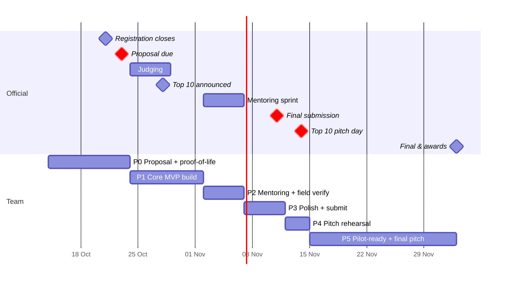

# Timeline & Milestones

> Today is **Wed 14 Oct 2026**. Official dates are in [../01-hackathon/hackathon-brief.md](../01-hackathon/hackathon-brief.md).
> Planning rule: **always have a working demo by Friday.** Each phase ends with something we could show a judge.

---

## P0: Proposal + proof-of-life (Wed 14 Oct → Fri 23 Oct)

**Goal:** submit a strong proposal **with a screenshot or video of a working spike**. A real prototype at proposal stage is rare, and it scores on *Feasibility* (20%) and *Team/Evidence* (10%).

| Date | Everyone | BE | FE | AI |
|---|---|---|---|---|
| Wed 14 | Read `docs/` (start at README). Confirm roles. **All members register on the portal.** | | | |
| Thu 15 | Kick-off sync: confirm site + stack (ADR 0005, 0006) | Repo scaffold (`apps/api`), OSM import of the site bbox → GeoJSON | Repo scaffold (`apps/web`), base 3D scene of the site renders | Pick provider, get API keys/credits, write the first 15 golden questions |
| Fri 16 | | Graph v0: about 30 nodes / 50 edges hand-annotated from OSM + Street View/photos, all `unknown` unless sourced | Overlay graph GeoJSON on the 3D scene | Tool-loop skeleton with 2 tools (`find_place`, `plan_route`) against BE mocks |
| Sat–Sun 17–18 | **Optional site visit** (pair): photos + attributes for the main entrances and one route | | | |
| Mon 19 | Sync: is the spike end-to-end? | `plan_route` with profiles + route status | Chat panel + route highlight from a map action | System prompt v1, answer format, abstain rule |
| Tue 20 | | Deploy API | Deploy web | Run golden set v0, fix the worst failures |
| Wed 21 | **Registration closes. Team leader bundles the team; every member accepts the invite.** Proposal draft v1 (see [../06-pitch/proposal-outline.md](../06-pitch/proposal-outline.md)) | | Record a 60–90 s demo video | |
| Thu 22 | Proposal review: each person reviews it against the [judging mapping](../01-hackathon/judging-criteria-mapping.md) | | Screenshots for the proposal | Eval numbers for the proposal (even small ones) |
| **Fri 23** | **Submit the proposal before noon** (leave a buffer for portal issues) | | | |

**Exit criteria:** proposal submitted; a deployed URL where one question ("stroller route from the Lakeside Mall car park to the Urban Park playground") returns a highlighted route with at least one `unknown` flagged.

---

## P1: Core MVP build (Sat 24 Oct → Sun 1 Nov), during judging

Keep building whatever the result. It costs nothing, and if we're Top 10 we start the mentoring sprint already ahead.

| Lane | Deliverables |
|---|---|
| BE | Full world-model schema + DB; all 6 tools as functions + REST; VR workflow (create/dedupe/resolve); evidence upload; closures with time ranges; 80% test coverage on routing |
| FE | Evidence cards; uncertainty badges; 2D fallback + list mode; staff console v1 (VR queue + attribute editor); mobile layout |
| AI | All tools wired; VR auto-trigger; multilingual check (BM/中文); persona simulation v1 (3 personas × 10 tasks); golden set grows to about 40 questions; CI eval run |
| All | **Wed 28 Oct: Top 10 announcement.** Prepare 5 questions to ask mentors |

## P2: Mentoring sprint + field verification (Mon 2 → Fri 6 Nov)

- Present the current demo to mentors on day 1, then log all feedback as issues.
- **Field verification visit**: verify every attribute on the demo routes, attach evidence photos, and set `verified_at`.
- **User testing**: 4–6 short sessions comparing TownshipLens with a "Google Maps + FAQ page" baseline (protocol in [../03-product/evaluation-plan.md](../03-product/evaluation-plan.md)).
- Close the loop live: one gap found in testing → VR → staff fix → better answer. **Record this. It is the core of the pitch.**

## P3: Polish + final submission (Sat 7 → Wed 11 Nov)

- Freeze features on Sun 8 Nov. After that, only bug fixes and polish.
- Final eval run; put the numbers into the deck.
- Demo video (2–3 min), deck, final docs, README with a live URL.
- **Submit the final on Tue 10 Nov** (one day of buffer).

## P4: Pitch rehearsal (Thu 12 → Sat 14 Nov)

- At least 5 full rehearsals with a timer, plus a judge Q&A drill ([../06-pitch/judge-qa.md](../06-pitch/judge-qa.md)).
- Back-up plan: offline recording of the demo, in case the venue Wi-Fi or the LLM API fails.

## P5: If we advance (15 Nov → 3 Dec)

- Turn mentor feedback into a **pilot proposal**: a 4–8 week pilot at one SDP facility, with KPIs, cost and data-governance plan ([../06-pitch/business-case.md](../06-pitch/business-case.md)).
- Extend to a second facility to *prove* scalability (onboarding time per facility is the KPI).

---

## Risk calendar

| Risk | When it bites | Mitigation |
|---|---|---|
| Not every member accepts the portal invite | 21–23 Oct | Do it on **Wed 21**, not Fri |
| Site visit blocked (weather, permission) | P0/P2 | Use Street View + public photos for v0 data and keep it marked `unverified` (that is honest and fits our story) |
| 3D data licence issue | any time | The 2D fallback is always working; the 3D layer can be swapped |
| LLM API outage or quota at demo | 14 Nov | Cached demo responses + recorded video |
| Scope creep | P1 | Anything not in [../03-product/mvp-spec.md](../03-product/mvp-spec.md) goes to the "later" list |
